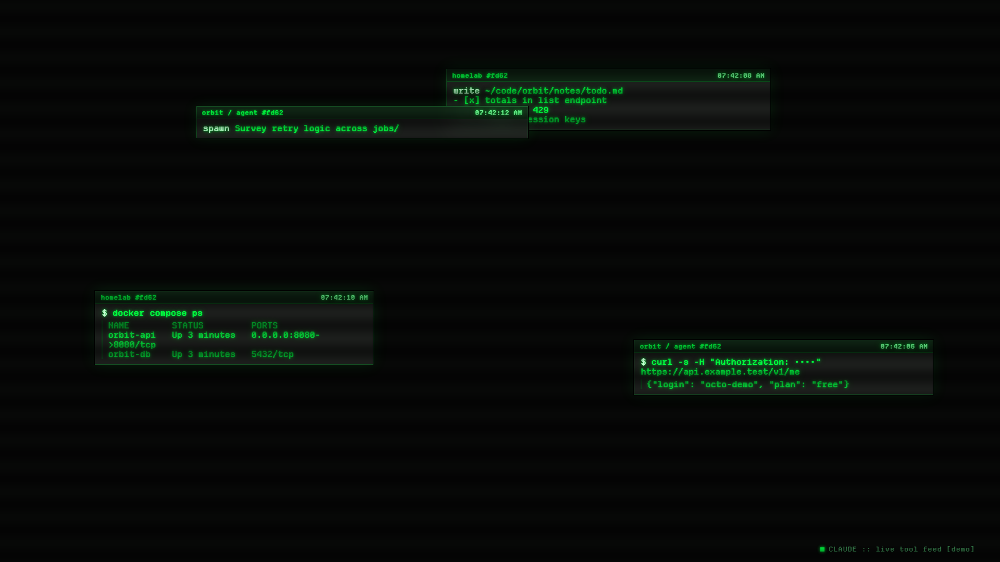
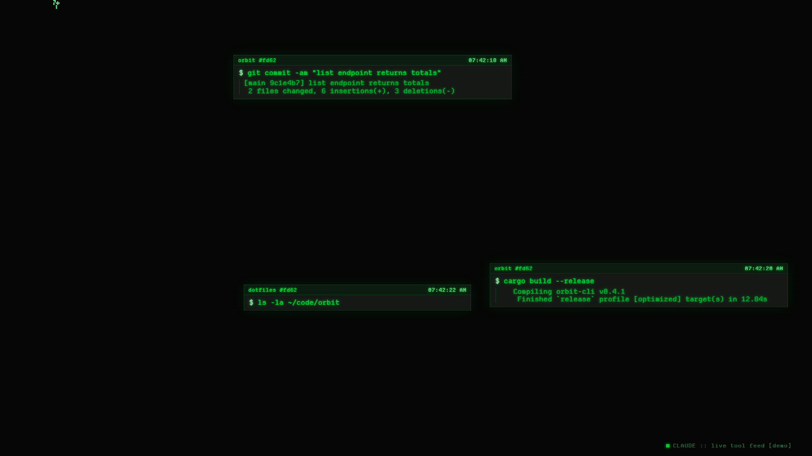

<div align="center">

# `g l i t c h w a l l`

**Your AI coding agent, live on your desktop.**
Every command it runs glitches onto your wallpaper, types itself out, and dies like an old CRT.


<sub>Recorded in demo mode with made-up commands. Notice the Stripe key and the bearer token: masked before they ever reached the screen.</sub>

</div>

---

## Why

Your agent is doing a hundred things a minute in a terminal you're not watching.
**glitchwall** turns that into the coolest wallpaper you've ever had:

- 🟩 **Live.** Commands, file edits, reads, searches and web fetches pop up the moment they run, with their output typed out underneath.
- 📺 **Retro to the bone.** Phosphor-green [Departure Mono](https://departuremono.com), frosted glass cards, RGB-split glitch-in, CRT collapse-out, 1px scanlines over everything, dim pixel rain behind.
- 🔒 **Paranoid by design.** 50 secret formats, credential assignments, high-entropy strings, your home path, user name and email are all masked *before* anything is stored. Localhost only. No telemetry. Read-only on your logs.
- 🎥 **Stream-safe.** One command (`glitchwall pause`) and the screen is clean, enforced by the feed itself, not the wallpaper.
- 🪶 **Tiny.** Pure Python standard library, zero dependencies, a single HTML page. Or a standalone `.exe` if you don't have Python.
- 🎛️ **Tweakable.** Typing speed, linger time, cards on screen, rain density and glass opacity, all from Lively's sliders.

## Quick start

### 1 · Just look at it (nothing installed, no logs read)

```
uvx glitchwall demo --open
```

Starts a fake feed and opens the wallpaper in your browser at `http://127.0.0.1:47834/`. Ctrl+C to stop.
<sub>Not on PyPI yet. From a clone of this repo: `uvx --from . glitchwall demo --open`.</sub>

### 2 · Windows + [Lively Wallpaper](https://github.com/rocksdanister/lively) (free, open source)

**With Python / uv:**

```
uv tool install glitchwall
glitchwall install
```

**Without Python:** grab `glitchwall-<version>-windows.zip` from [Releases](https://github.com/marklesterb28/glitchwall/releases), unzip, then in that folder:

```
.\glitchwall.exe install
```

`install` copies the wallpaper into Lively's library, starts the feed in the background,
adds a start-at-logon entry and switches Lively to it. Your previous wallpaper is remembered
and comes back on `uninstall`.

The exe version copies `glitchwall.exe` and `glitchwall-feed.exe` (the windowed feed that starts
at logon, no console window) into `%USERPROFILE%\.glitchwall\bin`, so you can delete the download.
Use `%USERPROFILE%\.glitchwall\bin\glitchwall.exe pause` (or `resume`, `status`, `uninstall`) from then on.
The exes aren't code-signed yet, so SmartScreen may say "unknown publisher". Each release lists
SHA-256 hashes to check your download against.

### 3 · macOS / Linux

```
uv tool install glitchwall
glitchwall install
```

This writes the wallpaper to the state folder, adds a login item (LaunchAgent / XDG autostart),
starts the feed and prints the page's `file://` path. Then either point a web-wallpaper app at it
([Plash](https://github.com/sindresorhus/Plash) on macOS, [Komorebi](https://github.com/Komorebi-Fork/komorebi)
or KDE's HTML wallpaper plugins on Linux), or open it fullscreen on a spare monitor:
`chromium --kiosk file:///path/to/index.html` (or `firefox --kiosk`).
A `file://` page sends `Origin: null`, which the feed accepts with the key.
<sub>The macOS/Linux path is written but not tested yet. Reports welcome.</sub>

## Going live? 🎥

```
glitchwall pause     # before you stream or share your screen
glitchwall resume    # after
```

Pausing happens **in the feed**: it serves nothing at all, and the wallpaper wipes every card on screen
the moment it notices. Put `pause` in your stream-start script and forget about it.
Want a lighter option? `glitchwall config --commands-only on` shows the calls but never their output.

## Commands

| Command | What it does |
| --- | --- |
| `glitchwall install` | set everything up (`--commands-only`, `--no-autostart`, `--no-set`, `--port N`) |
| `glitchwall status` | what's installed and running |
| `glitchwall start` / `stop` | start or stop the background feed |
| `glitchwall pause` / `resume` | stream-safe switch: serve nothing / back to live |
| `glitchwall config --commands-only on` | show calls, hide all output |
| `glitchwall config --label "TEXT"` | the text in the bottom-right corner |
| `glitchwall demo [--open]` | fake events + the page, for screenshots and trying it |
| `glitchwall export DIR` | write the wallpaper and its `config.js` to a folder (other wallpaper apps) |
| `glitchwall uninstall` | remove everything `install` added and put your old wallpaper back |

## What it does, and what it never does

> **TL;DR:** it reads your agent's logs, masks the secrets, and shows them to one page on your own machine. That's it.

### ✅ It reads

- **Claude Code session logs:** `~/.claude/projects/*/*.jsonl` (or `$CLAUDE_CONFIG_DIR/projects`),
  opened **read-only**, only logs touched in the last 30 minutes, only the newly appended part.
  From each line it takes tool calls and their results.
- **Its own files:** a random key, `settings.json`, a pid file.
- **On Windows, two Lively files:** `Settings.json` and `WallpaperLayout.json`, to find the library and to know which wallpaper to put back.

### 🚫 It never

- **Talks to the internet.** The feed listens on `127.0.0.1` only and makes no outgoing connections.
  No telemetry, no analytics, no update checks. The page loads nothing remote (the font is bundled).
- **Writes to your logs**, or anywhere outside the files listed below.
- **Shows unmasked secrets.** Text is redacted *before* it's stored in memory, so there's nothing unredacted to leak. See [Redaction](#redaction).
- **Serves anyone but the wallpaper.** Every request needs:
  - the per-install random key, which only the wallpaper's `config.js` has, compared in constant time;
  - a `Host` of `127.0.0.1`/`localhost` on the right port, which blocks DNS rebinding;
  - no `Origin`, `null` (a local file page) or `*.localhost` (how Lively serves wallpapers).

  Websites you visit can't read it. Refused requests are noted in `last-refused.txt`, without the key.

### 📁 Files it adds (all removed by `uninstall`)

| Where | What |
| --- | --- |
| `%USERPROFILE%\.glitchwall\` (Windows), `~/Library/Application Support/glitchwall/` (macOS), `~/.local/state/glitchwall/` (Linux) | key, settings, pid file, refusal note, previous-wallpaper note (and `bin\` for the exe version) |
| `<Lively library>\wallpapers\glitchwall\` | the wallpaper page and its `config.js` |
| `HKCU\...\CurrentVersion\Run\glitchwall` / `~/.config/autostart/glitchwall.desktop` / `~/Library/LaunchAgents/io.github.glitchwall.plist` | start at logon |

**Why the home folder on Windows, not `%LOCALAPPDATA%`?** Packaged (MSIX) apps such as Claude Desktop
or Store terminals get new AppData folders redirected into a private copy. `install` run from one of
them and the feed started at logon would then read different key files, and every request would be
refused. Set `GLITCHWALL_HOME` to put the state somewhere else.

## Redaction

Applied to every command, file path and output before it's kept:

| Layer | What it catches |
| --- | --- |
| **Known formats** | AWS, Google, Azure (storage keys, SAS signatures), GitHub, GitLab, Slack (tokens and webhooks), Discord, Stripe, Anthropic, OpenAI, Hugging Face, npm, PyPI, NuGet, Docker Hub, DigitalOcean, HashiCorp Vault, Tailscale, SendGrid, Mailgun, Twilio, Doppler, Grafana, Netlify, Vercel, Telegram and more; JWTs; PEM / OpenSSH / PGP / PuTTY / age private keys |
| **By name** | `password=`, `API_KEY: …`, `"client_secret": "…"`, `export X_TOKEN=`, `$env:X_KEY =`, `setx`, `--password x`, `--api-key=x`, `mysql -pX`, `curl -u user:pass`, `Authorization:` / `Cookie:` / `X-Api-Key:` headers, `.netrc`, credentials in URLs and connection strings (`postgres://user:pass@`, `Password=…;`) |
| **High entropy** | long random-looking tokens (mixed case + digits, high Shannon entropy) and long hex strings, even with no known prefix |
| **Personal** | home folder → `~` (all Windows, Git Bash and WSL spellings), user name → `user`, email local parts → `••••` |
| **Optional** | `--commands-only` drops all tool output |

It errs toward masking. The tests in [`tests/test_redact.py`](tests/test_redact.py) feed 50+ realistic fake
secrets through it, plus ordinary text that must survive untouched.

## ⚠️ Disclaimers (please read)

- **Redaction is a safety net, not a guarantee.** It's pattern- and entropy-based. A secret with no
  known format, no telling variable name and low randomness (say, a dictionary-word password typed as a
  bare argument) can get through. **You are responsible for what's on your screen.** When streaming,
  recording or screen sharing, use `glitchwall pause`.
- **It can't protect you from local malware.** Any program already running as you can read your
  agent's logs and this tool's key file directly.
- **Your logs contain whatever your agent did.** glitchwall shows a masked slice of that; it doesn't
  decide what your agent runs.
- **`config.js` holds your feed key.** Don't publish an exported wallpaper folder. If you did, delete
  the `key` file in the state folder and run `glitchwall install` again.
- **Provided as is, with no warranty**, under the MIT license. See [LICENSE](LICENSE) and [SECURITY.md](SECURITY.md).
- **Not affiliated with Anthropic or Lively Wallpaper.** "Claude" and "Claude Code" are trademarks of
  Anthropic; they're named here only to say which logs glitchwall reads.
- **Free and open source, forever.** No accounts, no paid tier, no ads.

## FAQ

**Will it slow my PC down?** It's one small Python process that checks for new log lines once a second,
and one web page. Lively pauses wallpapers when a fullscreen app (game, video) is in front.

**Does it work with other agents?** It reads Claude Code's logs today. The parser is one small file
([`claude_logs.py`](src/glitchwall/claude_logs.py)), and pull requests for other agents are welcome.

**Can I change the look?** Lively's sliders cover typing speed, linger time, cards on screen, rain and
glass opacity. Everything else is plain CSS in [`index.html`](src/glitchwall/wallpaper/index.html).

**Upgrading from 0.1.x (then called `agent-live-wallpaper`)?** `glitchwall install` stops the old feed,
keeps its settings (with a new key), and removes the old state folder, autostart entry and Lively folder.
Then run `uv tool uninstall agent-live-wallpaper`.

## Development

```
uv run python -m unittest discover -s tests                          # tests
uv build                                                             # wheel + sdist
powershell -File packaging\build-exe.ps1                             # standalone Windows exes + zip (PyInstaller, build time only)
uv run --no-project --with pillow --with websockets python tools/record_demo.py   # re-record docs/demo.gif
```

Stdlib only at runtime, Python 3.9+.

| File | Role |
| --- | --- |
| `src/glitchwall/claude_logs.py` | follow the logs, pair each call with its output |
| `src/glitchwall/redact.py` | all masking |
| `src/glitchwall/server.py` | the local feed and its access checks |
| `src/glitchwall/platforms.py` | Lively, autostart, background process, standalone exe |
| `src/glitchwall/wallpaper/` | the page itself (`index.html?still` renders without animation, for screenshots) |

<details>
<summary>More screenshots</summary>




</details>

## License & credits

**MIT**, see [LICENSE](LICENSE). Free to use, change and share.
[Departure Mono](https://departuremono.com) is © Helena Zhang, SIL Open Font License 1.1, see [OFL.txt](src/glitchwall/wallpaper/OFL.txt).
Wallpaper host: [Lively Wallpaper](https://github.com/rocksdanister/lively) by rocksdanister.

<div align="center"><sub>made for people who like watching the machine think</sub></div>
