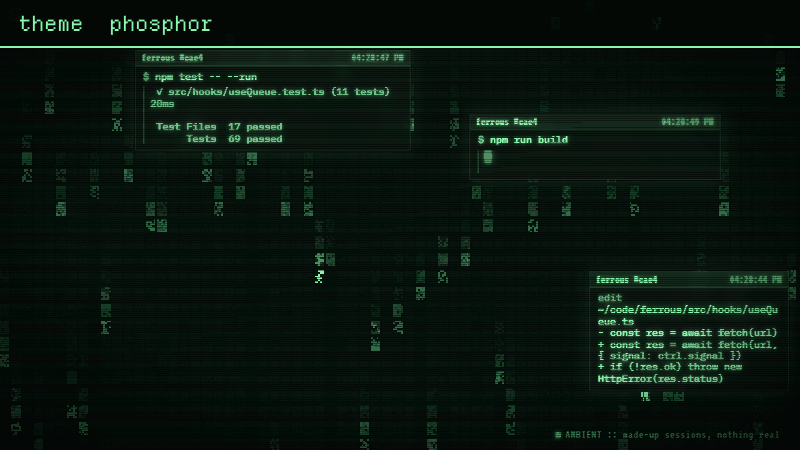
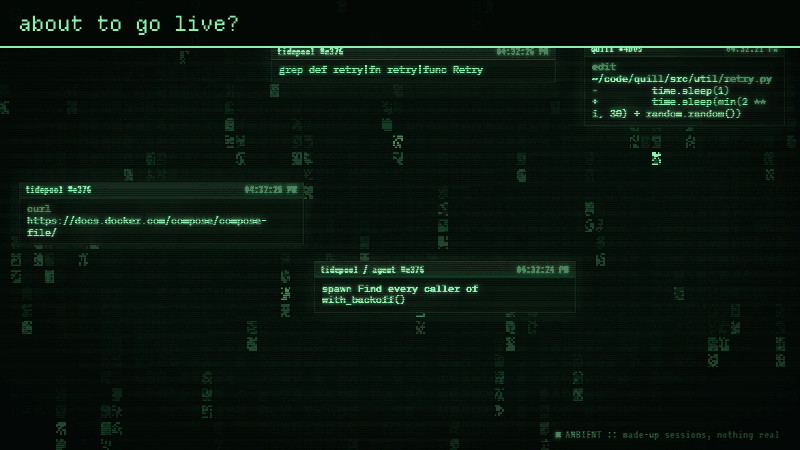
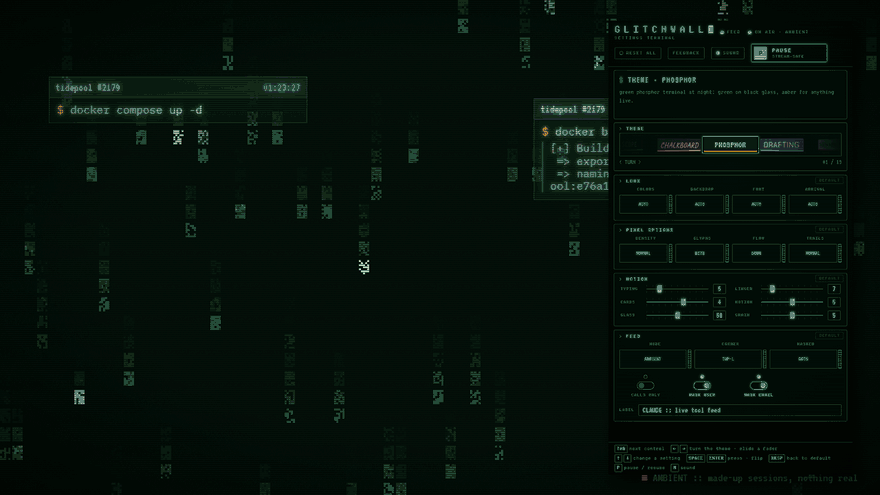
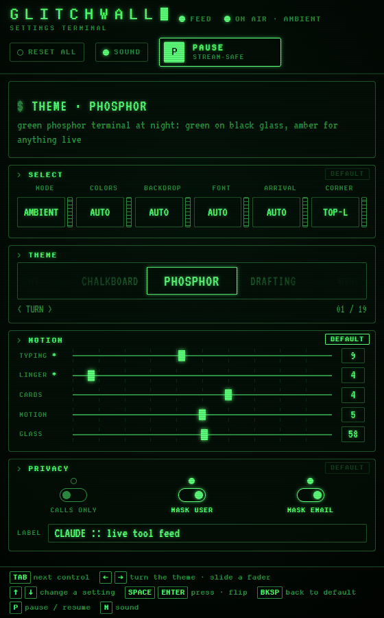
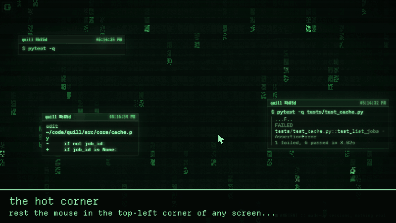
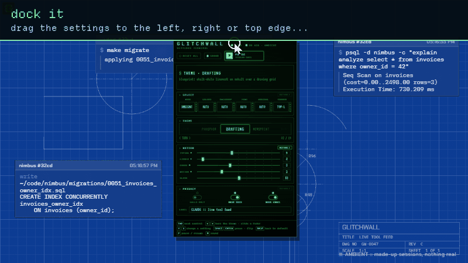
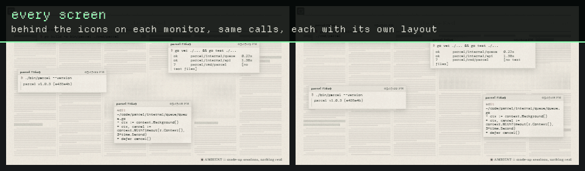
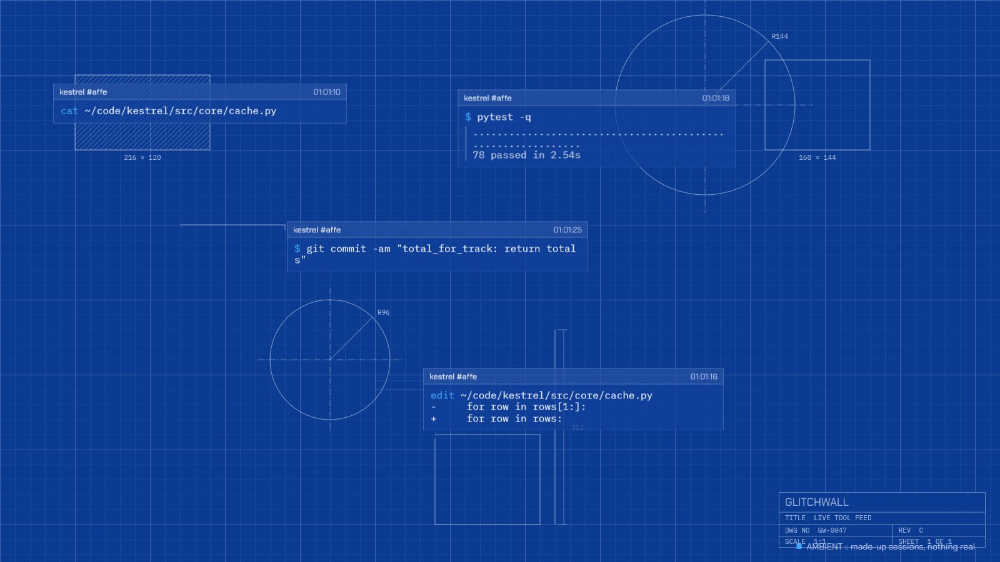
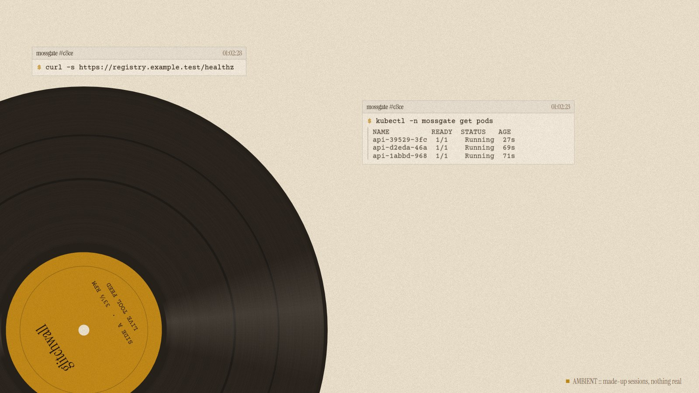
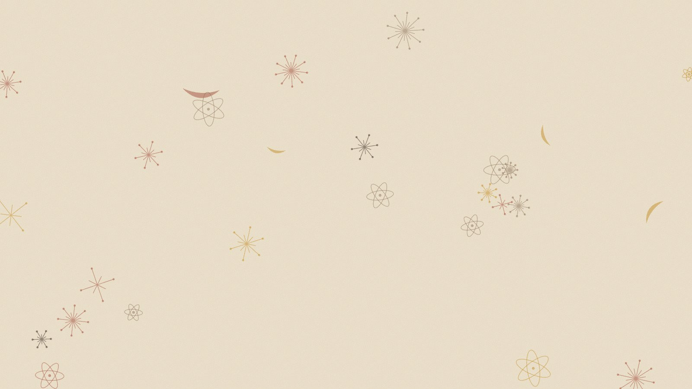

<div align="center">

# `g l i t c h w a l l`

**Your AI coding agent, live on your desktop.**
Every command it runs lands on your wallpaper, types itself out with its output, and fades away in the style of the theme you picked.


[](https://ko-fi.com/marklesterb28)


<sub>Recorded in demo mode with made-up commands. Notice the Stripe key and the bearer token: masked before they ever reached the screen.</sub>

**[Tour](#the-tour-) · [Quick start](#quick-start) · [Themes](#themes-) · [Commands](#commands) · [Privacy](#what-it-does-and-what-it-never-does) · [FAQ](#faq)**

</div>

---

Your agent does a hundred things a minute in a terminal you're not watching. **glitchwall** puts all of it on
your desktop, behind your icons: every command, file edit, search and web fetch appears the moment it runs and
types itself out with its result. Secrets are masked before anything is stored, nothing ever leaves your
machine, and one click clears the screen before you go live. No coding agent? It plays made-up sessions or just
the art.

- 🟩 **Live:** your real Claude Code tool calls as they happen, with their output.
- 🎨 **19 themes, 27 backgrounds, 19 fonts, 19 transitions:** mix any of them.
- 🔒 **Private:** masked before it's stored, localhost only, no telemetry, read-only on your logs.
- 🎥 **Stream-safe:** one switch and the screen is clean, enforced by the feed itself.
- 🖥️ **No wallpaper app:** on Windows it sits behind your desktop icons on every screen by itself.
- 🌙 **No code needed:** ambient mode plays made-up sessions forever; art mode is just the background.
- 🪶 **Small:** the Python standard library and one web page (plus [pywebview](https://github.com/r0x0r/pywebview) on Windows). Free and MIT licensed.

## The tour 🎬

Every clip below is the real page (and the real settings window), recorded with made-up data.

### Every call, the moment it runs

Shell and PowerShell commands, file reads, edits and writes, searches, web fetches and sub-agents each get a
card. The card types the call out, then its output underneath; a failing command's output shows in the
theme's error color. Cards
land somewhere free on the screen, linger a few seconds after they finish, and leave the way your theme likes.
The corner label shows a lamp that lights while calls are coming in. (That's the clip at the top of this page.)

It reads Claude Code's own session logs (read-only, only what's new), so there's nothing to set up in Claude
Code itself.

### Nineteen looks, each one complete



A green phosphor terminal, a blueprint, newsprint by day and night, neon signs in the rain, a field-ops map, a
risograph print, a record sleeve, a school notebook, an all-seeing machine's ring of data and the black sphere it
lives in, a lab oscilloscope, a chalkboard, the old blue stop screen, a sun print, and four classic terminals. Each theme is a finished bundle: colors, two fonts, a background, a texture, and its own way
of bringing cards in and taking them away (beam open and collapse, ruled in and erased, stamped and torn off,
written in and crumpled up...). The full list is under [Themes](#themes-).

### Make it yours


Five independent choices: start from a theme, then borrow another theme's colors, pick any background, any
font, any transition. Every change shows up on the running wallpaper within a second; nothing restarts.

### Twenty-seven backgrounds


Every theme has a background of its own, and you can put any of them behind any theme: bit-glyph rain, katakana
falling at three depths, a starfield, dead-channel static, snow, a synthwave sun, a drafting grid that draws and
dimensions its own shapes, a breathing halftone, a turning record, a jukebox, atomic-age starbursts, a broadcast
test card, mid-century wallpaper, a newspaper page setting itself, neon signs in the rain, a field map, ferns on
a sun print, a radar sweep, a DOS desktop, an oscilloscope, a chalkboard, the stop screen, a doodling notebook,
the oracle's ring, the orb in its data hall, or nothing. The MOTION slider sets how busy any of them is, down to perfectly still.

### Three modes: no coding agent needed


| Mode | What you see | What it reads |
| --- | --- | --- |
| `live` (default) | your real Claude Code tool calls as they happen | your Claude Code logs, read-only |
| `ambient` | endless made-up coding sessions: a bug found and fixed, tests failing then passing, a build, a deploy, a release, with believable code, projects and numbers | nothing at all |
| `art` | just the themed background | nothing at all |

So glitchwall works as a wallpaper even if you don't write code. The corner label says which mode is on, so a
made-up session is never mistaken for a real one. `glitchwall install --mode ambient` to start that way,
`glitchwall config --mode art` (or the MODE selector) to switch any time.

### Secrets never reach the screen


Everything is masked in the feed *before* it's stored, so the page never even receives the real text: 50+ key
formats (cloud, Git hosts, payment, AI providers, package registries...), anything assigned to a secret-sounding
name, passwords in URLs, headers and command lines, long random-looking tokens, and your home folder, user
name and email. Details under [Redaction](#redaction).

### One switch before you go live



`glitchwall pause` (or the big PAUSE key in the settings, or **P**) and the feed stops serving: the wallpaper
wipes every card on screen within a second and the label says *paused*. Nothing that happens during a pause is
ever replayed. Put it in your stream-start script. Something in between? **CALLS ONLY** shows the calls but never
their output.

### A settings window that previews on the real thing



Open **glitchwall settings** from the Start menu, the desktop's right-click menu, the hot corner, or
`glitchwall settings`. Every control saves and applies the moment you touch it. **Hold** any slider, selector or
the theme drum and the window fades almost away, so the wallpaper itself is your preview; let go and it's back.
It speaks keyboard too (arrows turn and slide, Backspace puts a control back to default), clicks and clacks
like a piece of lab gear (**SOUND** or **M** turns that off; the wallpaper is always silent), and each section
has a DEFAULT key. **RESET ALL** (press twice) puts everything back and restarts the wallpaper fresh.

[](docs/shots/settings.png)

### Five sliders


**TYPING** speed (1 to 20), **LINGER** after a card finishes (2 to 30 s), **CARDS** on screen at once (1 to 6),
**MOTION** of the background (0 is still, 10 is full), and **GLASS** (see-through to solid cards). Also on the
command line: `glitchwall config --type-speed 8 --linger 12 --cards 3 --intensity 2 --glass 80`.

### A hot corner



Rest the mouse in the top-left corner of any screen for half a second and the settings open (or come to the
front). A small glitching glitchwall icon marks the corner. Pick any corner, or OFF, with the CORNER selector;
it never fires while a game or video is fullscreen.

### Dock it to an edge



Drag the settings window to the left, right or top edge of a screen and it docks there, on top. After a few idle
seconds it tucks itself into a thin strip; touch the strip and it slides back out. Drag it away to undock.
<sub>(Put together from the real settings window and wallpaper: docking happens on your desktop, not in a page.)</sub>

### Every screen, behind your icons



On Windows there's no wallpaper app to install: glitchwall puts one borderless window per screen behind your
desktop icons, using WebView2, the Edge engine built into Windows. Screens added, removed or rearranged are
picked up on their own, and so is a restarted Explorer. If the page's browser ever dies, glitchwall restarts
itself. Your own wallpaper is never changed: `stop` or `uninstall` uncovers it again. Only want the main screen?
`glitchwall install --screens primary`.

### Light on your PC

One small Python process that checks for new log lines once a second, and one web page per screen that draws
at most 30 frames a second, whatever your monitor's refresh rate. A screen covered by a maximized or
fullscreen window (a game, a video, your editor) goes to sleep until it's uncovered, and so does every screen
while the PC is locked: about 17% of one core awake, 2.4% asleep. MOTION at 0 stills the background entirely.
In Task Manager it shows up as **glitchwall**, not as an anonymous Python. How that stacks up against other
live wallpapers: [How it compares](#how-it-compares-with-other-live-wallpapers).

## Quick start

### 1 · Just look at it (nothing installed, no logs read)

From a clone of this repo:

```
uvx --from . glitchwall demo --open
```

Starts a fake feed and opens the wallpaper in your browser at `http://127.0.0.1:47834/`. Ctrl+C to stop.

### 2 · Windows

**With Python / uv**, from a clone of this repo:

```
uv tool install .
glitchwall install
```

**Without Python:** build the standalone exes (see [Development](#development)), unzip
`glitchwall-<version>-windows.zip`, then in that folder:

```
.\glitchwall.exe install
```

`install` first checks that everything it needs is there (Windows 10 1803 or newer, .NET Framework 4.7.2,
the WebView2 runtime) and offers to fetch what isn't: the WebView2 runtime comes straight from Microsoft, and
runs only if Windows confirms Microsoft signed it. Nothing is downloaded without a yes (`--yes` answers yes
for scripts). `glitchwall doctor` runs the same checks any time.

Then it starts the feed in the background, adds a start-at-logon entry, and puts the wallpaper behind
your desktop icons on every screen (Windows 10 gets WebView2 with Edge; Windows 11 has it built in). To change
anything, open **glitchwall settings** from the Start menu, the desktop's right-click menu (on Windows 11 under
*Show more options*), the hot corner, or `glitchwall settings`. See [the tour](#the-tour-) for what's in there.

The exe version copies `glitchwall.exe` and `glitchwall-feed.exe` (the windowed feed that starts
at logon, no console window) into `%USERPROFILE%\.glitchwall\bin`, so you can delete the download.
Use `%USERPROFILE%\.glitchwall\bin\glitchwall.exe pause` (or `resume`, `status`, `uninstall`) from then on.
The exes aren't code-signed, so SmartScreen may say "unknown publisher".

## Themes 🎨


Each theme is a finished bundle: colors, two fonts, a background, a texture and its own way of bringing cards
in and taking them away. Use one as it is, or swap any single part.

| Theme | Personality | Cards arrive / leave |
| --- | --- | --- |
| `phosphor` (default) | green phosphor terminal at night: green on black glass, amber for anything live, bit-glyph rain, CRT tube | beam opens / collapses to a dot |
| `drafting` | blueprint: chalk-white linework on cobalt, shapes drafting, dimensioning and hatching themselves, a title block in the corner | ruled in / erased |
| `newsprint` · `nightprint` | cream newsprint, black ink, hot vermilion, a broadsheet page setting itself line by line under the cards; the same at night on charcoal | pressed on / lifted off |
| `neon` | near-black neon: cyan ink, hot pink, dot-matrix titles, neon signs buzzing on a wet brick wall in the rain | tube flickers on / off |
| `fieldops` | field-ops: khaki stock, hot orange, stencil type, a contour map with a route drawing itself from waypoint to objective | stamped / torn off |
| `duplicator` | risograph: blue and fluorescent-pink inks, halftone, the pink drum a little off true | second ink lands off true |
| `sleeve` | record sleeve: sepia paper, brown ink, mustard, a record turning in the corner | slides out of the sleeve |
| `notebook` | ruled paper, red margin, ballpoint handwriting, pencil doodles | written in / crumpled and tossed |
| `bsod` | the old blue stop screen: white VGA text, grey title chips | drawn line by line / gone |
| `cyanotype` | a sun print in Prussian blue: fern and leaf silhouettes developing pale, brushed edges to the coating | fades in / fades out |
| `oracle` | an all-seeing machine: one great ring of jagged data strokes on black, slowly turning and always redrawing itself, white ink and one signal red | opens like an iris / closes to a point |
| `orb` | the same machine seen whole: a ribbed black sphere sunk in the floor of a vast, empty, dark data hall, rows of racks blinking away into the haze behind it, tiny red lights flickering and streaming along its slats, readouts pointing at its parts as they turn into view | a curved shadow sweeps off / over it |
| `scope` | a lab oscilloscope: a blue-white beam sweeping a graticule, its trace glowing yellow-green and fading slowly, the signal changing every few sweeps, readouts at the corners | swept in by the beam / fades like an afterglow |
| `chalkboard` | a blackboard smudged with old lessons: equations, plots and little flowcharts written up in chalk, then wiped with the eraser | written in a few letters at a time / smudged and wiped |
| `matrix` · `amber` · `synthwave` · `msdos` | bright-green katakana falling at three depths, an amber radar sweep, a synthwave sunset, blue DOS boxes on a text-mode desktop | glitch · beam · slides across · docks beside the last one |

**Mix and match.** Five independent choices; `theme` means "whatever the theme uses":

```sh
glitchwall themes                                   # list everything, * marks what you use now
glitchwall config --theme drafting                  # pick a bundle; the running wallpaper switches within a second
glitchwall config --palette sleeve                  # ...but with another theme's colors
glitchwall config --rain starburst --font vt323     # ...any background, any font
glitchwall config --transition neon                 # ...any way of arriving and leaving
glitchwall config --palette theme --rain theme --font theme --transition theme   # back to the bundle
glitchwall demo --open --theme notebook             # try one without touching your setup
```

| Choice | Options |
| --- | --- |
| **Background** (`--rain`) | `pixel` bit-glyph rain · `code` katakana rain · `stars` · `static` · `snow` · `grid` synthwave sun · `draft` drawing grid · `halftone` two-ink dots · `record` · `jukebox` · `starburst` atomic age · `testcard` · `print` mid-century wallpaper · `stop` stop screen · `notebook` ruled paper · `oracle` ring of data · `orb` the machine in its data hall · `cascade` katakana at three depths · `scope` oscilloscope · `radar` · `textmode` DOS desktop · `broadsheet` newspaper page · `signs` neon in the rain · `topo` field map · `sunprint` ferns and leaves · `chalk` blackboard · `none` |
| **Font** | `departure` · `plex` · `vt323` · `chakra` · `doto` · `stencil` · `serif` · `courierprime` · `dmmono` · `fira` · `overpass` · `georgia` · `cascadia` · `consolas` · `lucida` · `courier` · `segoe` · `hand` · `mono` |
| **Transition** | `glitch` · `crt` · `draft` · `press` · `neon` · `stamp` · `riso` · `sleeve` · `dos` · `write` · `iris` · `eclipse` · `trace` · `chalk` · `slide` · `fade` · `dock` beside the last card · `toast` stacked in the corner · `zoom` |
| **Palette** | any theme name |

Fonts are bundled or already on your system; nothing is downloaded at run time. The sliders are
`glitchwall config --type-speed 1-20 --linger 2-30 --cards 1-6 --intensity 0-10 --glass 20-95`, and they
apply within a second. In a browser, URL parameters (`?theme=sleeve&rain=jukebox&transition=stamp`) win over
your settings, and `?cycle=10` steps through every theme. The background slider sets how busy any background is (0 stills it).

### How the themes are built

A few rules every theme follows:

- **One whole look, not a skin.** Colors, two fonts (one for titles, one for the typing), a background, a
  texture over everything, film grain, and the way cards arrive and leave are chosen together. You can swap any
  one part; the bundle is the starting point.
- **Borrowed from real things, copied from none.** Each look starts from a real object or medium (a blueprint, a
  risograph, an oscilloscope, a chalkboard) and is drawn from scratch: nothing is a copy of a game, a film or a
  show. The first eight follow the palettes and personalities of SUB/WAVE's themes (see License & credits).
- **The cards come first.** The background is a backdrop for the tool calls, so every background stays darker or
  quieter than the cards, and nothing in it competes with the text you're meant to read.
- **Motion only where it means something.** A background moves as fast as its subject does and no faster: a
  record turns, a page sets line by line, a sun print develops slowly. That's why the frame rates below differ.
- **Fonts ship with glitchwall.** Every font is bundled under the SIL Open Font License, so a theme looks the same
  on every PC and nothing is downloaded at run time.
- **Safe to stream.** No real names or accounts in any background, and every number on screen is made up.
- **Four options per background.** Each background has exactly four settings in the settings window: enough to
  make it yours, and few enough to fit in one row and stay polished.

#### Theme specs

The frame rate is how often the background redraws. Cards are separate: they redraw at 60 fps only while one
arrives, leaves or slides (about half a second), and otherwise only when text changes. When nothing moves,
nothing is drawn at all.

| Theme | Background | Titles / typing fonts | Texture, grain | Background fps | Why that rate |
| --- | --- | --- | --- | --- | --- |
| `phosphor` | `pixel` bit-glyph rain | VT323 / IBM Plex Mono | CRT tube, 0.06 | 30 | falling glyphs need smooth motion to read as rain |
| `drafting` | `draft` drawing grid | Chakra Petch / IBM Plex Mono | none, 0.08 | 30 | there's always a line being ruled; slower looks jerky |
| `newsprint` · `nightprint` | `broadsheet` | Gelasio / DM Mono | none, 0.4 · 0.25 | 15 while setting, 1 while the page holds | type setting is steady, not fast; a finished page only needs its clock |
| `neon` | `signs` in the rain | Doto / Fira Code | scan lines, 0.12 | 24 | rain and tube flicker; film rate is enough for both |
| `fieldops` | `topo` field map | Saira Stencil One / Overpass Mono | none, 0.08 | 24 | the route draws itself slowly |
| `duplicator` | `halftone` | DM Mono / DM Mono | halftone, 0.08 | 12 (0 when the drift is still) | the field breathes; more frames add nothing |
| `sleeve` | `record` | Instrument Serif / Courier Prime | none, 0.4 | 30 (0 when the record rests) | a turning label shows every dropped frame |
| `matrix` | `cascade` katakana at three depths | Departure Mono | scan lines, none | 30 | fast falling columns |
| `amber` | `radar` | Departure Mono | scan lines, none | 30 | the sweep is the whole point |
| `synthwave` | `grid` | Departure Mono | scan lines, none | 30 | the grid rolls toward you |
| `msdos` | `textmode` DOS desktop | VT323 | scan lines, none | 12 while the mouse moves, 1 otherwise | only the pointer and the clock change |
| `bsod` | `stop` screen | VT323 | scan lines, none | about 2 (the cursor blink), 0 with no blink | a still screen with a blinking cursor |
| `cyanotype` | `sunprint` ferns and leaves | Instrument Serif / IBM Plex Mono | none, 0.35 | 15 | a print develops slowly |
| `notebook` | `notebook` ruled paper | Caveat | none, 0.22 | 30 while a doodle is drawn, 0 after | a pencil stroke needs smooth motion; a finished doodle needs none |
| `oracle` | an all-seeing machine: one great ring of jagged data strokes on black, slowly turning and always redrawing itself, white ink and one signal red | opens like an iris / closes to a point |
| `orb` | the same machine seen whole: a ribbed black sphere sunk in the floor of a vast, empty, dark data hall, rows of racks blinking away into the haze behind it, tiny red lights flickering and streaming along its slats, readouts pointing at its parts as they turn into view | a curved shadow sweeps off / over it |
| `scope` | `scope` oscilloscope | Overpass Mono / IBM Plex Mono | CRT tube, 0.05 | 30 | a sweeping beam must look continuous |
| `chalkboard` | `chalk` blackboard | Caveat | none, 0.18 | 20 while writing or wiping | handwriting pace |

Every background drops to 0 fps when the background slider is at 0. The eight extra backgrounds belong to no
theme, for mixing your own: `code` and `stars` (30 fps), `snow` (30), `jukebox` and `starburst` (20), `static`,
`testcard` and `print` (15).

### Up close

Full-size shots (click one to open it). They come from ambient mode, so every session in them is made up.

<table>
<tr><td>

[](docs/shots/phosphor.jpg)<br><sub>phosphor</sub>

</td><td>

[](docs/shots/drafting.jpg)<br><sub>drafting</sub>

</td></tr>
<tr><td>

[](docs/shots/notebook.jpg)<br><sub>notebook</sub>

</td><td>

[](docs/shots/sleeve.jpg)<br><sub>sleeve</sub>

</td></tr>
<tr><td>

[](docs/shots/duplicator.jpg)<br><sub>duplicator</sub>

</td><td>

[](docs/shots/newsprint.jpg)<br><sub>newsprint</sub>

</td></tr>
<tr><td>

[](docs/shots/oracle.jpg)<br><sub>oracle</sub>

</td><td>

[](docs/shots/art-oracle.jpg)<br><sub>oracle, art mode</sub>

</td></tr>
<tr><td>

[](docs/shots/orb.jpg)<br><sub>orb</sub>

</td><td>

[](docs/shots/art-orb.jpg)<br><sub>orb, art mode</sub>

</td></tr>
<tr><td>

[](docs/shots/scope.jpg)<br><sub>scope</sub>

</td><td>

[](docs/shots/art-scope.jpg)<br><sub>scope, art mode</sub>

</td></tr>
<tr><td>

[](docs/shots/chalkboard.jpg)<br><sub>chalkboard</sub>

</td><td>

[](docs/shots/art-chalkboard.jpg)<br><sub>chalkboard, art mode</sub>

</td></tr>
<tr><td>

[](docs/shots/neon.jpg)<br><sub>neon</sub>

</td><td>

[](docs/shots/bsod.jpg)<br><sub>bsod</sub>

</td></tr>
<tr><td>

[](docs/shots/art-synthwave.jpg)<br><sub>synthwave, art mode</sub>

</td><td>

[](docs/shots/art-halftone.jpg)<br><sub>duplicator, art mode</sub>

</td></tr>
<tr><td>

[](docs/shots/art-starburst.jpg)<br><sub>sleeve + starburst, art mode</sub>

</td><td>

[](docs/shots/art-testcard.jpg)<br><sub>fieldops + testcard, art mode</sub>

</td></tr>
</table>

## Commands

| Command | What it does |
| --- | --- |
| `glitchwall install` | set everything up (`--mode ambient`, `--commands-only`, `--no-autostart`, `--screens primary`, `--yes`, `--port N`) |
| `glitchwall settings` | the settings: every setting below, applied as you change them (`--browser` opens it in your browser) |
| `glitchwall config --mode live\|ambient\|art` | real activity, made-up sessions, or background only |
| `glitchwall status` | what's installed and running |
| `glitchwall doctor` | check everything glitchwall needs, offer to fetch what's missing |
| `glitchwall reset` | every setting back to the default, wallpaper restarted fresh |
| `glitchwall start` / `stop` | start or stop the background feed |
| `glitchwall pause` / `resume` | stream-safe switch: serve nothing / back to live |
| `glitchwall config --commands-only on` | show calls, hide all output |
| `glitchwall terminal on\|off\|status` | opt-in: show the commands you type in PowerShell, cmd (with Clink) and WSL too ([what it records](#your-terminal-commands-opt-in)) |
| `glitchwall config --label "TEXT"` | the text in the bottom-right corner |
| `glitchwall themes` | list themes, backgrounds and fonts |
| `glitchwall config --theme X --rain Y --font Z` | change the look, live |
| `glitchwall demo [--open]` | fake events + the page, for screenshots and trying it |
| `glitchwall export DIR` | write the wallpaper and its `config.js` to a folder (other wallpaper apps) |
| `glitchwall uninstall` | remove everything `install` added and put your old wallpaper back |

## What it does, and what it never does

> **TL;DR:** it reads your agent's logs, masks the secrets, and shows them to one page on your own machine. That's it.

### ✅ It reads

In `ambient` and `art` mode it reads no logs at all, only its own settings. In `live` mode:

- **Claude Code session logs:** `~/.claude/projects/*/*.jsonl` (or `$CLAUDE_CONFIG_DIR/projects`),
  opened **read-only**, only logs touched in the last 30 minutes, only the newly appended part.
  From each line it takes tool calls and their results.
- **Its own files:** a random key, `settings.json`, a pid file.
- **Your own terminal commands, only if you turn that on** with `glitchwall terminal on`. Off until you do;
  see [Your terminal commands](#your-terminal-commands-opt-in).

### 🚫 It never

- **Talks to the internet.** The feed listens on `127.0.0.1` only and makes no outgoing connections.
  No telemetry, no analytics, no update checks. The page loads nothing remote (the fonts are bundled).
  The one part glitchwall doesn't control: WebView2 is Microsoft's Edge engine, and it may talk to
  Microsoft for its own updates and safety checks the way Edge does. The page itself only ever asks `127.0.0.1`.
- **Writes to your logs**, or anywhere outside the files listed below. (The terminal hooks, if you turn them on,
  add one line to your shell profiles; that line is listed below too, and `terminal off` or `uninstall` takes it out.)
- **Shows unmasked secrets.** Text is redacted *before* it's stored in memory, so there's nothing unredacted to leak. See [Redaction](#redaction).
- **Serves anyone but the wallpaper.** Every request needs:
  - the per-install random key, which only the wallpaper has (in its `config.js`, or after the `#` in the
    address of glitchwall's own windows, which is never sent to a server), compared in constant time;
  - a `Host` of `127.0.0.1`/`localhost` on the right port, which blocks DNS rebinding;
  - no `Origin`, `null` (a local file page), or the feed's own address (glitchwall's own windows load the
    page from the feed). Pages from other local servers are refused too.

  Changing a setting from the settings window needs all of that too, plus a JSON request sent from the
  feed's own address, so neither a website, a file page nor a plain form can change one. Port and screens
  can't be changed from it at all.

  Websites you visit can't read it. Refused requests are noted in `last-refused.txt`, without the key.

### 📁 Files it adds (all removed by `uninstall`)

| Where | What |
| --- | --- |
| `%USERPROFILE%\.glitchwall\` | key, settings, pid file, refusal note, `webview\` and `webview-settings\` (WebView2's caches for glitchwall's own windows), and `bin\` for the exe version |
| `HKCU\...\CurrentVersion\Run\glitchwall` / `~/.config/autostart/glitchwall.desktop` / `~/Library/LaunchAgents/io.github.glitchwall.plist` | start at logon |
| `%APPDATA%\Microsoft\Windows\Start Menu\Programs\glitchwall settings.lnk` | Windows: the settings window in the Start menu |
| `HKCU\Software\Classes\DesktopBackground\Shell\glitchwall` | Windows: *glitchwall settings* in the desktop's right-click menu |
| one line at the end of `Documents\PowerShell\profile.ps1`, `Documents\WindowsPowerShell\profile.ps1` and WSL's `~/.bashrc` | only after `glitchwall terminal on`: loads the terminal hook. Marked `# glitchwall terminal`; `terminal off` removes it too |
| `%USERPROFILE%\.glitchwall\clink\glitchwall.lua`, and that folder in Clink's script list | only after `glitchwall terminal on`, and only if Clink is set up for cmd: the cmd hook. `terminal off` takes the folder out of Clink's list (`clink uninstallscripts`) and deletes it |

### Your terminal commands (opt-in)

Off by default. `glitchwall terminal on` turns it on, `glitchwall terminal off` turns it off again, and
`glitchwall uninstall` removes it along with everything else. While it is on, the commands you type yourself show
on the wallpaper next to your agent's, as cards.

**What it adds.** One line at the end of your PowerShell profiles (PowerShell 7 and Windows PowerShell) and of
`~/.bashrc` in your default WSL distro. The line loads a short hook script from `~/.glitchwall/`
(`shell-hook.ps1` or `shell-hook.bash`). For cmd it copies `shell-hook.lua` to `~/.glitchwall/clink/` and adds that
folder to [Clink](https://github.com/chrisant996/clink)'s scripts with Clink's own `clink installscripts`. All three
are plain text, in this repo under `src/glitchwall/`, and worth reading before you turn this on. Nothing else in your
profiles is touched.

**cmd needs Clink.** cmd itself has no hook to run code after a command, so the cmd part works through Clink, a free
(GPL-3.0) add-on for cmd's prompt. glitchwall never installs Clink and never changes cmd's startup (its `AutoRun`
registry value). It only looks there to see whether Clink is already set up to start with cmd, by Clink's installer or
`clink autorun install`. If it isn't, `terminal on` says so and leaves cmd out. Two things about Clink itself, which
glitchwall doesn't control: it keeps its own command history (`clink_history` in its profile folder), and by default it
checks GitHub for new versions now and then (`clink set clink.autoupdate off` turns that off).

**What the hooks record.**

| | PowerShell | cmd (Clink) | WSL (bash) |
| --- | --- | --- | --- |
| the command you typed | yes, when you press Enter | yes, when you press Enter | yes, as it starts |
| what it printed | yes: read off the console screen when it finishes, and every second while it runs | yes: read off the console screen when the next prompt comes (the last 60 lines at most) | yes: the feed reads it off the WSL window's screen (see below) when it finishes, and every 2 seconds while it runs (for 10 minutes at most) |
| commands left out | lines PowerShell can't run yet (unfinished input) | a line starting with a space | whatever bash leaves out of its history: a leading space (`HISTCONTROL=ignorespace`), a repeat (`ignoredups`) |

**Where it goes.** Each shell window appends to its own file, `~/.glitchwall/shell/<process id>.jsonl` (cmd:
`cmd-<process id>.jsonl`, WSL: `wsl-<process id>.jsonl`), on this machine. Nothing is sent anywhere: the hooks only write that file, and the feed
reads it the same way it reads Claude Code's logs. A file is cut back when it passes 256 KB, and the feed deletes a
shell's file a day after it was last written.

**How WSL output is read.** bash can't see its own screen, so when the hook says a command is done, the feed starts a
short-lived helper (`python -I -m glitchwall.wslscreen`) that attaches to each open `wsl.exe` window's console in turn,
copies the text on screen (read-only, nothing is typed or changed), and exits. The feed keeps only the lines between
your command and the next prompt. Windows only lets it read windows running as you; an administrator window refuses.

**Who could misuse it.** The hooks, their files and your profiles are writable only by your own account (and
administrators): another user on the PC can't change them. The hooks never run anything they record; the recorded
text is only ever shown, as plain text (never as HTML), after masking. A program already running as you could write
fake lines into the hook files and so put made-up cards on your wallpaper, but nothing more: it could do far worse to
your account directly.

**Before it shows.** The feed reads these files only in `live` mode, only while the `terminal` setting is on
(the tray's *Show* menu, or the settings window), and never while paused. Every line goes through the same
[redaction](#redaction) as your agent's calls before it is kept or shown, so tokens, keys, passwords, your user name
and email addresses are masked. Nothing is recorded in a PowerShell or cmd window running as administrator, or in a root shell in WSL: the
hooks switch themselves off there.

**Keeping one command out.** In cmd or WSL, start it with a space: the hook never writes it down. Pausing glitchwall
(`glitchwall pause`, or the tray menu) keeps everything off the wallpaper, but the hooks still write to their local
files while paused (the feed skips what was written during the pause and never shows it later). To stop the
recording itself, `glitchwall terminal off` and open a new window.

**Why the home folder on Windows, not `%LOCALAPPDATA%`?** Packaged (MSIX) apps such as Claude Desktop
or Store terminals get new AppData folders redirected into a private copy. `install` run from one of
them and the feed started at logon would then read different key files, and every request would be
refused. Set `GLITCHWALL_HOME` to put the state somewhere else.

## Redaction

Applied to every command, file path and output before it's kept:

| Layer | What it catches |
| --- | --- |
| **Known formats** | AWS, Google, Azure (storage keys, SAS signatures), GitHub, GitLab, Slack (tokens and webhooks), Discord, Stripe, Anthropic, OpenAI, Hugging Face, npm, PyPI, NuGet, Docker Hub, DigitalOcean, HashiCorp Vault, Tailscale, SendGrid, Mailgun, Twilio, Doppler, Grafana, Netlify, Vercel, Telegram and more; JWTs; PEM / OpenSSH / PGP / PuTTY / age private keys |
| **By name** | `password=`, `API_KEY: …`, `"client_secret": "…"`, `export X_TOKEN=`, `$env:X_KEY =`, `setx`, `--password x`, `--api-key=x`, `mysql -pX`, `curl -u user:pass`, `Authorization:` / `Cookie:` / `X-Api-Key:` headers, `.netrc`, credentials in URLs and connection strings (`postgres://user:pass@`, `Password=…;`) |
| **High entropy** | long random-looking tokens (mixed case + digits, high Shannon entropy) and long hex strings, even with no known prefix |
| **Personal** | home folder → `~` (all Windows, Git Bash and WSL spellings), user name → `user`, email local parts → `••••` |
| **Optional** | `--commands-only` drops all tool output |

It errs toward masking. The tests in [`tests/test_redact.py`](tests/test_redact.py) feed 50+ realistic fake
secrets through it, plus ordinary text that must survive untouched.

## How it compares with other live wallpapers

Nobody publishes like-for-like benchmarks of live wallpapers, so take this as a rough guide. Our numbers
are measured; most of the others are one person's test or a forum post, on different hardware, drawing
different things.

| | What it draws | CPU | Memory | Open source | Where the number comes from |
|---|---|---|---|---|---|
| **glitchwall** (Windows default: native) | Direct2D, no browser | 6.5% of one core (0.4% of a 16-core CPU) | 153 MB | yes | our test, below |
| **glitchwall** (web page in WebView2) | animated web page | 34% of one core (2.2%) | 699 MB | yes | our test, below |
| [Lively Wallpaper](https://github.com/rocksdanister/lively) | simple web wallpaper (rain) | under 0.3% of the whole CPU | about 245 MB | yes | [one reviewer](https://www.windowscentral.com/software-apps/i-finally-tried-lively-wallpaper-to-animate-my-desktop-its-a-dream-for-customization) |
| Lively Wallpaper | a YouTube page as wallpaper | about 4.5% of the whole CPU | about 800 MB | yes | same reviewer |
| Wallpaper Engine | 60 fps video, hardware decoding | 1-2% of the whole CPU, ~40% GPU | not given | no | [forum post](https://steamcommunity.com/app/431960/discussions/2/1696045708644625403) |
| [anipaper](https://github.com/Theldus/anipaper) (Linux) | 1080p 30 fps video, hardware decoding | 10.8% of a 4-core CPU (about 43% of one core) | not given | yes | author's benchmark |
| [Hidamari](https://github.com/jeffshee/hidamari) (Linux) | video, Intel integrated GPU | about 1% CPU, 4% GPU | not given | yes | [article author](https://ubuntuhandbook.org/index.php/2024/10/video-animated-wallpaper-ubuntu/) |
| macOS aerial wallpapers | built-in video | 20-100% CPU when it misbehaves | up to GBs | no | [bug reports](https://discussions.apple.com/thread/255180158) |

Our test: a 16-core Windows 11 desktop, matrix theme, ambient mode, every glitchwall process counted (the
feed and the renderer), the desktop showing, 30 seconds. Native: three runs of 6.2-6.7% (2026-11-23); the
default phosphor theme came out the same, and orb, the busiest background, at 10.3% of one core and 172 MB.
The web page figure is from 2026-11-22.

**What the native renderer does.** On Windows, glitchwall draws every background with Direct2D straight from
a small Rust program, with no browser in between: about a fifth of the CPU and a fifth of the memory of the
web page. If the renderer is missing, it falls back to the page (`glitchwall config --renderer web` picks the
page on purpose). In OBS and Wallpaper Engine, the web page is the way to run glitchwall.

**Why the web page is heavier than a video wallpaper.** A video wallpaper hands its work to the graphics
card's video decoder, so the CPU barely notices. glitchwall draws every frame live (falling glyphs, cards,
text), and the page does it in WebView2, a full copy of the Edge browser: a browser process, a GPU process
and a renderer for each page. That's where most of its memory goes; Lively's web wallpapers use the same
engine and land in the same range. Either way, glitchwall caps frame rates per background (10-30 fps, 60 only
while a card slides in), and sleeps entirely while a screen is covered, fullscreen or locked, like Lively and
Wallpaper Engine do.

## ⚠️ Disclaimers (please read)

- **Redaction is a safety net, not a guarantee.** It's pattern- and entropy-based. A secret with no
  known format, no telling variable name and low randomness (say, a dictionary-word password typed as a
  bare argument) can get through. **You are responsible for what's on your screen.** When streaming,
  recording or screen sharing, use `glitchwall pause`.
- **It can't protect you from local malware.** Any program already running as you can read your
  agent's logs and this tool's key file directly.
- **Your logs contain whatever your agent did.** glitchwall shows a masked slice of that; it doesn't
  decide what your agent runs.
- **`config.js` holds your feed key.** Don't publish an exported wallpaper folder. If you did, delete
  the `key` file in the state folder and run `glitchwall install` again.
- **Provided as is, with no warranty**, under the MIT license. See [LICENSE](LICENSE) and [SECURITY.md](SECURITY.md).
- **Not affiliated with Anthropic.** "Claude" and "Claude Code" are trademarks of
  Anthropic; they're named here only to say which logs glitchwall reads.
- **Free and open source, forever.** No accounts, no paid tier, no ads. Donations are appreciated but never
  required, and they don't unlock anything. See [Support](#support-).

## FAQ

**Will it slow my PC down?** Hardly: see [Light on your PC](#light-on-your-pc). For the lightest setup,
`glitchwall config --intensity 0` stills the background.

**Does it work with other agents?** It reads Claude Code's logs today. The parser is one small file
([`claude_logs.py`](src/glitchwall/claude_logs.py)), and pull requests for other agents are welcome.

**Can I change the look?** Yes: see [Themes](#themes-). A new theme is one entry in `THEMES` in
[`index.html`](src/glitchwall/wallpaper/index.html) plus its name in [`themes.py`](src/glitchwall/themes.py);
a test checks they agree. Pull requests welcome.

**Does it run on macOS or Linux?** Not today: glitchwall is Windows only (tested on Windows 11). Its renderer draws with
Direct2D and sits behind your icons through the Windows desktop, both Windows-only. A version for macOS and Linux
would need a cross-platform renderer and a desktop host for each system, tested on real machines, which this
project doesn't have yet.

**Can I use another wallpaper app?** You don't need one: on Windows glitchwall puts itself behind your
icons. But the wallpaper is a plain web page and the feed is a local web server, so anything that can show
a web page can show it. `glitchwall export DIR` writes the page and its `config.js` to a folder. Use that folder in Wallpaper Engine
(as a web wallpaper), a browser window in kiosk mode, or an OBS **browser source** to put your agent on
stream as an overlay (`glitchwall pause` still clears it instantly). Only glitchwall's own windows are tested so far;
reports welcome.

## How glitchwall got here

**The idea (21 November 2026).** It started as `agent-live-wallpaper`: a wallpaper that shows what a coding agent is
doing, live, as it works. A small local feed follows the agent's logs, pairs each call with its output, masks
secrets, and serves it to a web page behind the desktop icons. It was renamed glitchwall the same day, got a
standalone exe, and grew from 8 looks to 15, then the oracle.

**Making it safe.** A wallpaper that shows your terminal is only useful if it never shows a secret. Three review
passes went after the leaks: user names and passwords in paths and URLs, bursts of old calls on start, a race in
saving settings, a stale access key. Later a security pass narrowed which pages may talk to the feed and taught
the redactor more secret shapes. A pause switch blanks everything at once, for going live.

**Owning the desktop.** glitchwall first leaned on Lively Wallpaper to sit behind the icons. It then got a desktop
host of its own: one window per screen, behind the icons, taking no mouse input, snapping back if Windows moves it,
and coming back by itself if the browser engine crashes. Lively support was removed.

**The settings window, five times over.** It was a cipher machine, then green phosphor lamps on the same case, then
a rotary drum of themes, then a green phosphor terminal. One version showed the settings as bars around the edges
of the screen with the real wallpaper live in the middle. That hit a wall: WebView2 paints over any hole cut in its
window, so the middle stayed grey. After proving it against a plain Win32 window, that version was dropped for a
small window that fades away while you hold a slider, so the real wallpaper is the preview.

**The cost problem.** Every theme now had its own animated background, and it showed in Task Manager. The page ran
in WebView2, a full copy of the Edge browser, and drew at the monitor's refresh rate. Capping frame rates and
sleeping while the screen is covered helped, but measured honestly it still took about a third of a CPU core and
700 MB, far more than a wallpaper should.

**Going native.** A prototype drew the phosphor theme with Direct2D, first in C#, then in Rust, and measured
it against WebView2: about 3.5% CPU and 63 MB against 18% and 330 MB. That settled it. The plan:

1. Put every theme, background, font and transition in one file (`looks.js`) that both the page and the new
   renderer read, so a theme is defined once.
2. A small Rust renderer (`glitchwall-render`) that reads the same feed as the page and draws behind the icons.
3. Port the backgrounds one at a time, each checked against the page side by side.
4. Make native the default on Windows, and keep the page for OBS and Wallpaper Engine.

**The hurdles on the way:**

- **Toolchain.** Newer versions of Rust's `windows` crate need extra build tools: either a large download or tools
  that aren't free software. glitchwall stays on version 0.58, the last that builds with the stock toolchain.
- **Neon letters.** The neon signs glow along the shape of each letter, which a browser does with a blurred
  shadow. Natively, each letter is turned into its outline, drawn into its own small picture, blurred twice for the
  glow and lit with a bright core.
- **Chalk.** A chalkboard has to remember everything written on it until it's wiped. Native chalk draws into a
  second surface that keeps the writing, and wipes it the way an eraser would.
- **The orb.** The busiest scene: a ribbed sphere, a triangle-net cage, hundreds of red lights and racks fading
  into haze. It's drawn as layers made once, plus lights drawn in batches each frame.
- **Display scaling, docked cards, stacked cards**: each had to match the page exactly.
- **Measuring honestly.** Early numbers came out impossibly low because a window covered the screen and glitchwall
  had (correctly) gone to sleep. Every number in this README is taken with the desktop showing.

**The payoff (23 November 2026).** All 27 backgrounds run natively, the 18 theme ones with four options each, and native is the
default on Windows. With the same looks, glitchwall now uses 6.5% of one core and 153 MB, down from 34% and 699 MB:
about a fifth of the CPU and a fifth of the memory (see [How it compares](#how-it-compares-with-other-live-wallpapers)).
The web page is still there, unchanged, for OBS browser sources and Wallpaper Engine.

## Development

```
uv run python -m unittest discover -s tests                          # tests
uv build                                                             # wheel + sdist
powershell -File packaging\build-exe.ps1                             # standalone Windows exes + zip (PyInstaller, build time only)
uv run --no-project --with pillow --with websockets python tools/record_demo.py   # re-record docs/demo.gif
uv run --no-project --with pillow --with websockets python tools/theme_gallery.py  # rebuild docs/themes.png
uv run --no-project --with pillow --with websockets python tools/screenshots.py   # rebuild docs/shots/ (the "Up close" gallery)
uv run --no-project --with pillow --with websockets python tools/showcase.py      # re-record the tour's GIFs (docs/gifs/) and the settings still
uv run --no-project --with pillow python tools/make_icon.py                       # redraw the app icon (pixel art, 16-256 px)
```

Standard library only at runtime, Python 3.9+; on Windows, plus [pywebview](https://github.com/r0x0r/pywebview) for the desktop windows.

| File | Role |
| --- | --- |
| `src/glitchwall/claude_logs.py` | follow the logs, pair each call with its output |
| `src/glitchwall/redact.py` | all masking |
| `src/glitchwall/server.py` | the local feed and its access checks |
| `src/glitchwall/themes.py` | theme, background and font names (the colors live in the page) |
| `src/glitchwall/winhost.py` | Windows: the page behind the desktop icons, one window per screen |
| `src/glitchwall/prereqs.py` | what `install` and `doctor` check for, and fetching what's missing |
| `src/glitchwall/platforms.py` | autostart, background process, standalone exe |
| `src/glitchwall/wallpaper/` | the page itself (`index.html?still` renders without animation, for screenshots) and the settings window (`settings.html`) |

## Support ☕

glitchwall is **completely free** and always will be. Every theme, mode and feature is here for everyone, with no
paid version, no locked extras and no nagging. You don't owe anything to use it, share it or build on it.

If it brightens your desk and you'd like to say thanks, a donation is warmly appreciated but **never required**.
Starring the repo, reporting a bug or showing it to a friend helps just as much.

- 💚 [GitHub Sponsors](https://github.com/sponsors/marklesterb28): monthly or one-time, no fees taken by GitHub
- ☕ [Ko-fi](https://ko-fi.com/marklesterb28): a one-off coffee, card or PayPal

## License & credits

**MIT**, see [LICENSE](LICENSE). Free to use, change and share.
[Departure Mono](https://departuremono.com) is © Helena Zhang, SIL Open Font License 1.1, see [OFL.txt](src/glitchwall/wallpaper/OFL.txt).
VT323, IBM Plex Mono, Chakra Petch, Doto, Saira Stencil One, Instrument Serif, Courier Prime, DM Mono, Fira Code,
Overpass Mono, Gelasio, Caveat, Cascadia Mono, Inconsolata and DotGothic16 (cut down to the katakana the rains use) are bundled under the SIL Open Font License 1.1 (from [Google Fonts](https://github.com/google/fonts));
each license is in [fonts/licenses](src/glitchwall/wallpaper/fonts/licenses).
The first eight themes' palettes, and the grain, scanline and halftone textures, are adapted from the themes of
[SUB/WAVE](https://github.com/perminder-klair/subwave) by Parminder Klair (MIT). Go check it out, it's a lovely
self-hosted radio station. Notice in [THIRD_PARTY_NOTICES.md](THIRD_PARTY_NOTICES.md).
Desktop windows on Windows: [pywebview](https://github.com/r0x0r/pywebview) (BSD-3-Clause) with
[pythonnet](https://github.com/pythonnet/pythonnet) (MIT) and Microsoft's WebView2.

<div align="center"><sub>made for people who like watching the machine think</sub></div>
