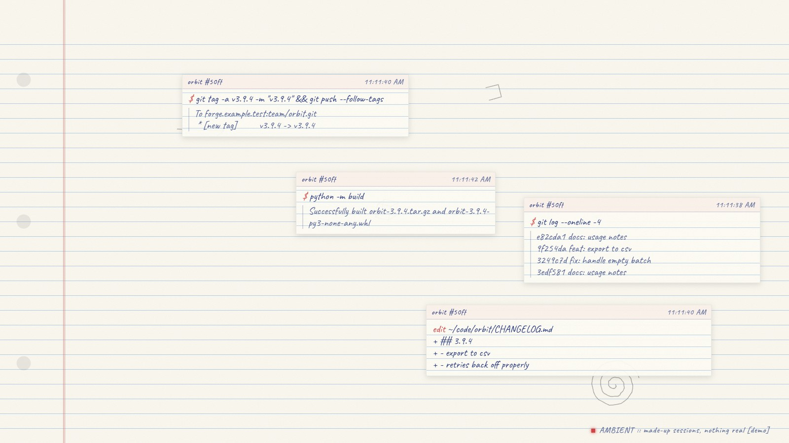
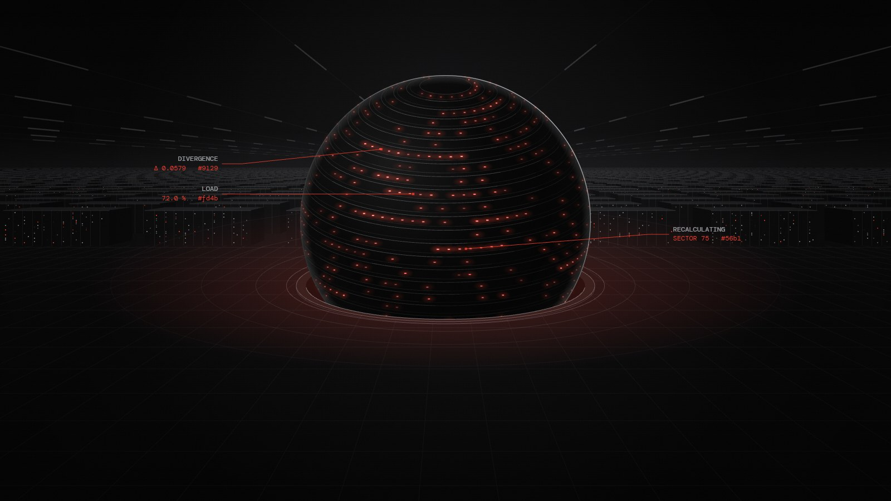
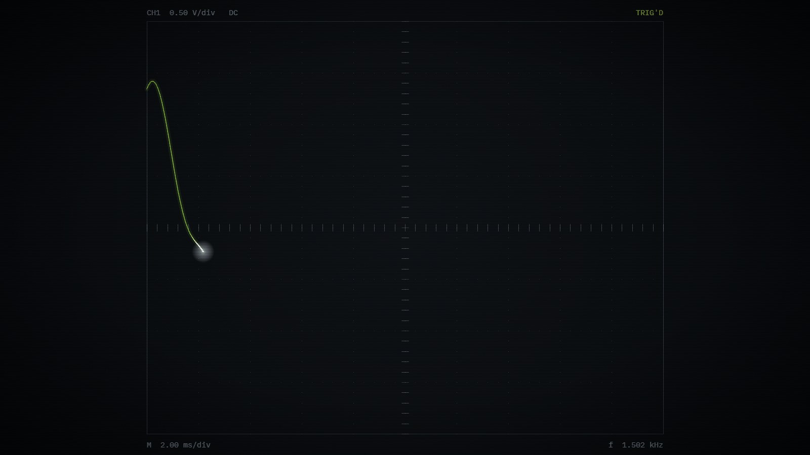
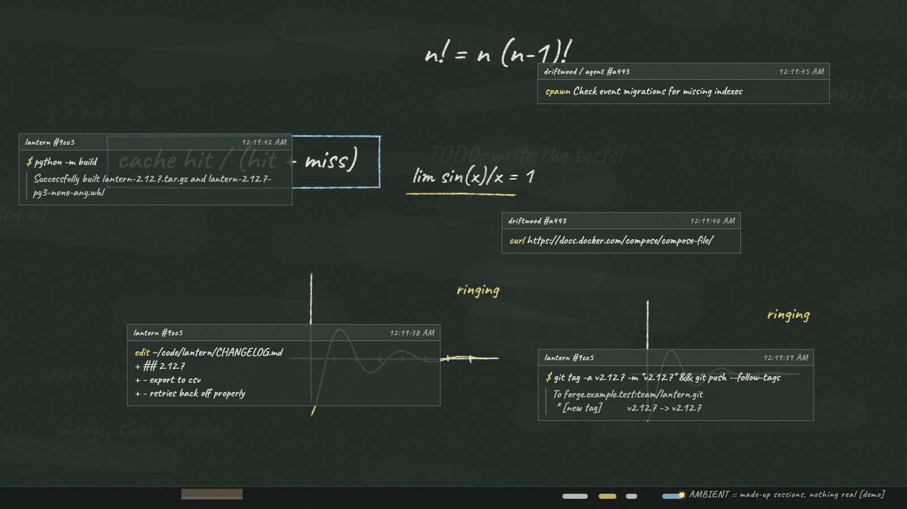
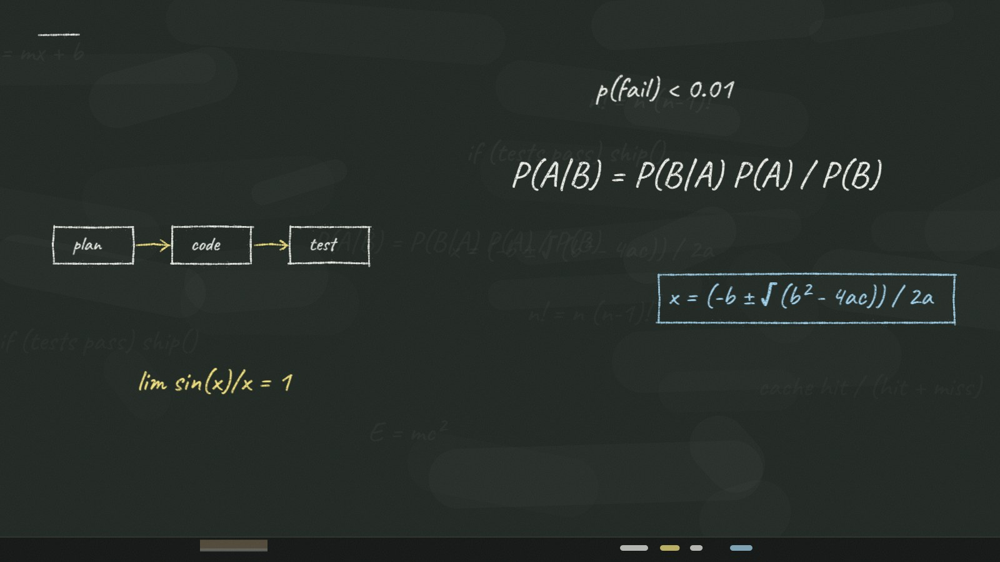
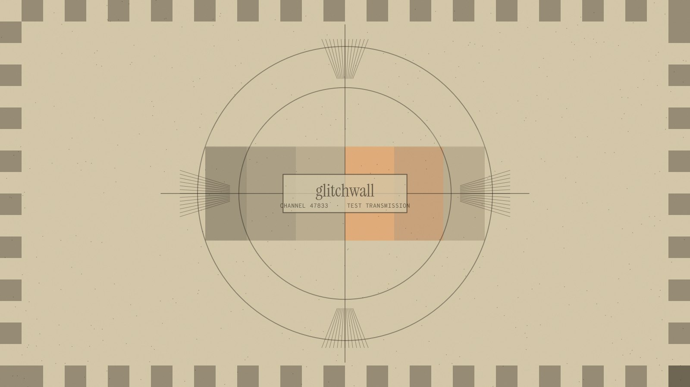

<div align="center">

# `g l i t c h w a l l`

**Your AI coding agent, live on your desktop.**
Every command it runs glitches onto your wallpaper, types itself out, and dies like an old CRT.


[](https://ko-fi.com/marklesterb28)


<sub>Recorded in demo mode with made-up commands. Notice the Stripe key and the bearer token: masked before they ever reached the screen.</sub>

</div>

---

## Why

Your agent is doing a hundred things a minute in a terminal you're not watching.
**glitchwall** turns that into the coolest wallpaper you've ever had:

- 🟩 **Live.** Commands, file edits, reads, searches and web fetches pop up the moment they run, with their output typed out underneath.
- 📺 **Retro to the bone.** [Departure Mono](https://departuremono.com) in phosphor green (by default), frosted glass cards, RGB-split glitch-in, CRT collapse-out, 1px scanlines over everything.
- 🔒 **Paranoid by design.** 50 secret formats, credential assignments, high-entropy strings, your home path, user name and email are all masked *before* anything is stored. Localhost only. No telemetry. Read-only on your logs.
- 🎥 **Stream-safe.** One command (`glitchwall pause`) and the screen is clean, enforced by the feed itself, not the wallpaper.
- 🪶 **Tiny.** Pure Python standard library and a single HTML page; on Windows, one small library ([pywebview](https://github.com/r0x0r/pywebview)) to put it behind your desktop icons. Or a standalone `.exe` if you don't have Python.
- 🖥️ **Every screen, no extra app.** On Windows it shows itself behind the desktop icons on every monitor and naps while a game or video is fullscreen. [Lively Wallpaper](https://github.com/rocksdanister/lively) works too, if you prefer it.
- 🎨 **Nineteen themes, twenty-seven backgrounds, fourteen transitions.** A green phosphor terminal, a lab oscilloscope, a chalkboard, a blueprint, newsprint by day and night, neon, a field-ops poster, a risograph print, a record sleeve, a school notebook, an old blue stop screen, an all-seeing machine's ring of data, the black sphere it lives in and more. Each is a finished bundle of colors, fonts, background, texture and its own way of bringing cards in and out, and you can swap any single part.
- 🌙 **No code of your own needed.** Ambient mode plays made-up but realistic coding sessions forever, and art mode shows just the background. Neither one reads anything. See [Not a coder?](#not-a-coder-).
- 🎛️ **Tweakable.** Typing speed, linger time, cards on screen, background intensity and glass opacity, in a settings window with a live preview (`glitchwall settings`, or *glitchwall settings* in the Start menu), with `glitchwall config`, or with Lively's sliders.

## Quick start

### 1 · Just look at it (nothing installed, no logs read)

```
uvx glitchwall demo --open
```

Starts a fake feed and opens the wallpaper in your browser at `http://127.0.0.1:47834/`. Ctrl+C to stop.
<sub>Not on PyPI yet. From a clone of this repo: `uvx --from . glitchwall demo --open`.</sub>

### 2 · Windows

**With Python / uv:**

```
uv tool install glitchwall
glitchwall install
```

**Without Python:** grab `glitchwall-<version>-windows.zip` from [Releases](https://github.com/marklesterb28/glitchwall/releases), unzip, then in that folder:

```
.\glitchwall.exe install
```

`install` first checks that everything it needs is there (Windows 10 1803 or newer, .NET Framework 4.7.2,
the WebView2 runtime) and offers to fetch what isn't: the WebView2 runtime comes straight from Microsoft, and
runs only if Windows confirms Microsoft signed it. Nothing is downloaded without a yes (`--yes` answers yes
for scripts). `glitchwall doctor` runs the same checks any time.

Then it starts the feed in the background, adds a start-at-logon entry, and puts the wallpaper behind
your desktop icons on every screen. No wallpaper app needed: glitchwall opens one borderless window per
screen with the page in WebView2, the Edge engine built into Windows 11 (Windows 10 gets it with Edge).
A screen with a fullscreen game or video in front sleeps until it's uncovered.

To change anything, open **glitchwall settings** from the Start menu, from the desktop's right-click menu
(on Windows 11 under *Show more options*), or run `glitchwall settings`: mode,
theme, colors, background, font, transitions, the five sliders, masking and the corner label, each one
saved the moment you change it, with a live preview of the wallpaper beside them. The big button at the
top is the stream-safe pause.

Every screen shows the same live calls, with the cards laid out differently. Only on the main screen?
`glitchwall install --screens primary`.

**Prefer [Lively Wallpaper](https://github.com/rocksdanister/lively)** (free, open source)? `glitchwall install --host lively`
copies the wallpaper into Lively's library and switches each screen to it instead; Lively's span and
duplicate layouts then apply. Either way, your previous wallpaper comes back on `uninstall`, each screen its own.

The exe version copies `glitchwall.exe` and `glitchwall-feed.exe` (the windowed feed that starts
at logon, no console window) into `%USERPROFILE%\.glitchwall\bin`, so you can delete the download.
Use `%USERPROFILE%\.glitchwall\bin\glitchwall.exe pause` (or `resume`, `status`, `uninstall`) from then on.
The exes aren't code-signed yet, so SmartScreen may say "unknown publisher". Each release lists
SHA-256 hashes to check your download against.

### 3 · macOS / Linux

```
uv tool install glitchwall
glitchwall install
```

This writes the wallpaper to the state folder, adds a login item (LaunchAgent / XDG autostart),
starts the feed and prints the page's `file://` path. Then either point a web-wallpaper app at it
([Plash](https://github.com/sindresorhus/Plash) on macOS, [Komorebi](https://github.com/Komorebi-Fork/komorebi)
or KDE's HTML wallpaper plugins on Linux), or open it fullscreen on a spare monitor:
`chromium --kiosk file:///path/to/index.html` (or `firefox --kiosk`).
A `file://` page sends `Origin: null`, which the feed accepts with the key.
<sub>The macOS/Linux path is written but not tested yet. Reports welcome.</sub>

## Themes 🎨


Each theme is a finished bundle: colors, two fonts, a background, a texture and its own way of bringing cards
in and taking them away. Use one as it is, or swap any single part.

| Theme | Personality | Cards arrive / leave |
| --- | --- | --- |
| `phosphor` (default) | green phosphor terminal at night: green on black glass, amber for anything live, bit-glyph rain, CRT tube | beam opens / collapses to a dot |
| `drafting` | blueprint: chalk-white linework on cobalt, shapes drafting, dimensioning and hatching themselves, a title block in the corner | ruled in / erased |
| `newsprint` · `nightprint` | cream newsprint, black ink, hot vermilion, a broadsheet page setting itself line by line under the cards; the same at night on charcoal | pressed on / lifted off |
| `neon` | near-black neon: cyan ink, hot pink, dot-matrix titles, neon signs buzzing on a wet brick wall in the rain | tube flickers on / off |
| `fieldops` | field-ops: khaki stock, hot orange, stencil type, a contour map with a route drawing itself from waypoint to objective | stamped / torn off |
| `duplicator` | risograph: blue and fluorescent-pink inks, halftone, the pink drum a little off true | second ink lands off true |
| `sleeve` | record sleeve: sepia paper, brown ink, mustard, a record turning in the corner | slides out of the sleeve |
| `notebook` | ruled paper, red margin, ballpoint handwriting, pencil doodles | written in / crumpled and tossed |
| `bsod` | the old blue stop screen: white VGA text, grey title chips | drawn line by line / gone |
| `cyanotype` | a sun print in Prussian blue: fern and leaf silhouettes developing pale, brushed edges to the coating | ruled in / erased |
| `oracle` | an all-seeing machine: one great ring of jagged data strokes on black, slowly turning and always redrawing itself, white ink and one signal red | opens like an iris / closes to a point |
| `orb` | the same machine seen whole: a ribbed black sphere sunk in the floor of a vast, empty, dark data hall, rows of racks blinking away into the haze behind it, tiny red lights flickering and streaming along its slats, readouts pointing at its parts as they turn into view | a curved shadow sweeps off / over it |
| `scope` | a lab oscilloscope: a blue-white beam sweeping a graticule, its trace glowing yellow-green and fading slowly, the signal changing every few sweeps, readouts at the corners | swept in by the beam / fades like an afterglow |
| `chalkboard` | a blackboard smudged with old lessons: equations, plots and little flowcharts written up in chalk, then wiped with the eraser | written in a few letters at a time / smudged and wiped |
| `matrix` · `amber` · `synthwave` · `msdos` | bright-green katakana falling at three depths, an amber radar sweep, a synthwave sunset, blue DOS boxes on a text-mode desktop | glitch · beam · glitch · line by line |

**Mix and match.** Five independent choices; `theme` means "whatever the theme uses":

```sh
glitchwall themes                                   # list everything, * marks what you use now
glitchwall config --theme drafting                  # pick a bundle; the running wallpaper switches within a second
glitchwall config --palette sleeve                  # ...but with another theme's colors
glitchwall config --rain starburst --font vt323     # ...any background, any font
glitchwall config --transition neon                 # ...any way of arriving and leaving
glitchwall config --palette theme --rain theme --font theme --transition theme   # back to the bundle
glitchwall demo --open --theme notebook             # try one without touching your setup
```

| Choice | Options |
| --- | --- |
| **Background** (`--rain`) | `pixel` bit-glyph rain · `code` katakana rain · `stars` · `static` · `snow` · `grid` synthwave sun · `draft` drawing grid · `halftone` two-ink dots · `record` · `jukebox` · `starburst` atomic age · `testcard` · `print` mid-century wallpaper · `stop` stop screen · `notebook` ruled paper · `oracle` ring of data · `orb` the machine in its data hall · `cascade` katakana at three depths · `scope` oscilloscope · `radar` · `textmode` DOS desktop · `broadsheet` newspaper page · `signs` neon in the rain · `topo` field map · `sunprint` ferns and leaves · `chalk` blackboard · `none` |
| **Font** | `departure` · `plex` · `vt323` · `chakra` · `doto` · `stencil` · `serif` · `courierprime` · `dmmono` · `fira` · `overpass` · `georgia` · `cascadia` · `consolas` · `lucida` · `courier` · `segoe` · `hand` · `mono` |
| **Transition** | `glitch` · `crt` · `draft` · `press` · `neon` · `stamp` · `riso` · `sleeve` · `dos` · `write` · `iris` · `eclipse` · `trace` · `chalk` |
| **Palette** | any theme name |

Fonts are bundled or already on your system; nothing is downloaded at run time. The sliders are
`glitchwall config --type-speed 1-20 --linger 2-30 --cards 1-6 --intensity 0-10 --glass 20-95`, and they
apply within a second. In Lively, the wallpaper's customize panel has the same five dropdowns and sliders,
and anything other than *Use glitchwall config* there wins over the command line. In a browser, URL parameters (`?theme=sleeve&rain=jukebox&transition=stamp`) win over both,
and `?cycle=10` steps through every theme. The background slider sets how busy any background is (0 stills it).

### Up close

Full-size shots (click one to open it). They come from ambient mode, so every session in them is made up.

<table>
<tr><td>

[](docs/shots/phosphor.jpg)<br><sub>phosphor</sub>

</td><td>

[](docs/shots/drafting.jpg)<br><sub>drafting</sub>

</td></tr>
<tr><td>

[](docs/shots/notebook.jpg)<br><sub>notebook</sub>

</td><td>

[](docs/shots/sleeve.jpg)<br><sub>sleeve</sub>

</td></tr>
<tr><td>

[](docs/shots/duplicator.jpg)<br><sub>duplicator</sub>

</td><td>

[](docs/shots/newsprint.jpg)<br><sub>newsprint</sub>

</td></tr>
<tr><td>

[](docs/shots/oracle.jpg)<br><sub>oracle</sub>

</td><td>

[](docs/shots/art-oracle.jpg)<br><sub>oracle, art mode</sub>

</td></tr>
<tr><td>

[](docs/shots/orb.jpg)<br><sub>orb</sub>

</td><td>

[](docs/shots/art-orb.jpg)<br><sub>orb, art mode</sub>

</td></tr>
<tr><td>

[](docs/shots/scope.jpg)<br><sub>scope</sub>

</td><td>

[](docs/shots/art-scope.jpg)<br><sub>scope, art mode</sub>

</td></tr>
<tr><td>

[](docs/shots/chalkboard.jpg)<br><sub>chalkboard</sub>

</td><td>

[](docs/shots/art-chalkboard.jpg)<br><sub>chalkboard, art mode</sub>

</td></tr>
<tr><td>

[](docs/shots/neon.jpg)<br><sub>neon</sub>

</td><td>

[](docs/shots/bsod.jpg)<br><sub>bsod</sub>

</td></tr>
<tr><td>

[](docs/shots/art-synthwave.jpg)<br><sub>synthwave, art mode</sub>

</td><td>

[](docs/shots/art-halftone.jpg)<br><sub>duplicator, art mode</sub>

</td></tr>
<tr><td>

[](docs/shots/art-starburst.jpg)<br><sub>sleeve + starburst, art mode</sub>

</td><td>

[](docs/shots/art-testcard.jpg)<br><sub>fieldops + testcard, art mode</sub>

</td></tr>
</table>

## Not a coder? 🌙

You don't need Claude Code, or any code, to use glitchwall. Pick a mode:

| Mode | What you see | What it reads |
| --- | --- | --- |
| `live` (default) | your real Claude Code tool calls as they happen | your Claude Code logs (see below) |
| `ambient` | endless made-up coding sessions: a bug found and fixed, tests failing then passing, a build, a deploy, a release. Believable code with fake projects, files and numbers | nothing at all |
| `art` | just the themed background, no cards, no label | nothing at all |

```
glitchwall install --mode ambient
glitchwall config --mode art        # switch any time; the running wallpaper follows within a second
```

Every theme, background and transition works the same in every mode. Preview without installing:
`glitchwall demo --open --mode ambient`.

## Going live? 🎥

```
glitchwall pause     # before you stream or share your screen
glitchwall resume    # after
```

Or press **PAUSE** at the top of the settings window. Pausing happens **in the feed**: it serves nothing at all, and the wallpaper wipes every card on screen
the moment it notices. Put `pause` in your stream-start script and forget about it.
Want a lighter option? `glitchwall config --commands-only on` shows the calls but never their output.

## Commands

| Command | What it does |
| --- | --- |
| `glitchwall install` | set everything up (`--mode ambient`, `--commands-only`, `--no-autostart`, `--screens primary`, `--host lively`, `--no-set`, `--port N`) |
| `glitchwall settings` | the settings window: every setting below, with a live preview (`--browser` opens it in your browser) |
| `glitchwall config --mode live\|ambient\|art` | real activity, made-up sessions, or background only |
| `glitchwall status` | what's installed and running |
| `glitchwall doctor` | check everything glitchwall needs, offer to fetch what's missing |
| `glitchwall start` / `stop` | start or stop the background feed |
| `glitchwall pause` / `resume` | stream-safe switch: serve nothing / back to live |
| `glitchwall config --commands-only on` | show calls, hide all output |
| `glitchwall config --label "TEXT"` | the text in the bottom-right corner |
| `glitchwall themes` | list themes, backgrounds and fonts |
| `glitchwall config --theme X --rain Y --font Z` | change the look, live |
| `glitchwall demo [--open]` | fake events + the page, for screenshots and trying it |
| `glitchwall export DIR` | write the wallpaper and its `config.js` to a folder (other wallpaper apps) |
| `glitchwall uninstall` | remove everything `install` added and put your old wallpaper back |

## What it does, and what it never does

> **TL;DR:** it reads your agent's logs, masks the secrets, and shows them to one page on your own machine. That's it.

### ✅ It reads

In `ambient` and `art` mode it reads no logs at all, only its own settings. In `live` mode:

- **Claude Code session logs:** `~/.claude/projects/*/*.jsonl` (or `$CLAUDE_CONFIG_DIR/projects`),
  opened **read-only**, only logs touched in the last 30 minutes, only the newly appended part.
  From each line it takes tool calls and their results.
- **Its own files:** a random key, `settings.json`, a pid file.
- **On Windows, two Lively files** (if Lively is installed): `Settings.json` and `WallpaperLayout.json`, to find the library and to know which wallpaper to put back.

### 🚫 It never

- **Talks to the internet.** The feed listens on `127.0.0.1` only and makes no outgoing connections.
  No telemetry, no analytics, no update checks. The page loads nothing remote (the fonts are bundled).
  The one part glitchwall doesn't control: WebView2 is Microsoft's Edge engine, and it may talk to
  Microsoft for its own updates and safety checks the way Edge does. The page itself only ever asks `127.0.0.1`.
- **Writes to your logs**, or anywhere outside the files listed below.
- **Shows unmasked secrets.** Text is redacted *before* it's stored in memory, so there's nothing unredacted to leak. See [Redaction](#redaction).
- **Serves anyone but the wallpaper.** Every request needs:
  - the per-install random key, which only the wallpaper has (in its `config.js`, or after the `#` in the
    address of glitchwall's own windows, which is never sent to a server), compared in constant time;
  - a `Host` of `127.0.0.1`/`localhost` on the right port, which blocks DNS rebinding;
  - no `Origin`, `null` (a local file page), `*.localhost` (how Lively serves wallpapers), or the feed's
    own address (glitchwall's own windows load the page from the feed).

  Changing a setting from the settings window needs all of that too, plus a JSON request sent by a page
  (with an `Origin`), so neither a website nor a plain form can change one. Port, host and screens can't
  be changed from it at all.

  Websites you visit can't read it. Refused requests are noted in `last-refused.txt`, without the key.

### 📁 Files it adds (all removed by `uninstall`)

| Where | What |
| --- | --- |
| `%USERPROFILE%\.glitchwall\` (Windows), `~/Library/Application Support/glitchwall/` (macOS), `~/.local/state/glitchwall/` (Linux) | key, settings, pid file, refusal note, previous-wallpaper note, `webview\` and `webview-settings\` (WebView2's caches for glitchwall's own windows), and `bin\` for the exe version |
| `<Lively library>\wallpapers\glitchwall\` | only with `--host lively`: the wallpaper page and its `config.js` |
| `HKCU\...\CurrentVersion\Run\glitchwall` / `~/.config/autostart/glitchwall.desktop` / `~/Library/LaunchAgents/io.github.glitchwall.plist` | start at logon |
| `%APPDATA%\Microsoft\Windows\Start Menu\Programs\glitchwall settings.lnk` | Windows: the settings window in the Start menu |
| `HKCU\Software\Classes\DesktopBackground\Shell\glitchwall` | Windows: *glitchwall settings* in the desktop's right-click menu |

**Why the home folder on Windows, not `%LOCALAPPDATA%`?** Packaged (MSIX) apps such as Claude Desktop
or Store terminals get new AppData folders redirected into a private copy. `install` run from one of
them and the feed started at logon would then read different key files, and every request would be
refused. Set `GLITCHWALL_HOME` to put the state somewhere else.

## Redaction

Applied to every command, file path and output before it's kept:

| Layer | What it catches |
| --- | --- |
| **Known formats** | AWS, Google, Azure (storage keys, SAS signatures), GitHub, GitLab, Slack (tokens and webhooks), Discord, Stripe, Anthropic, OpenAI, Hugging Face, npm, PyPI, NuGet, Docker Hub, DigitalOcean, HashiCorp Vault, Tailscale, SendGrid, Mailgun, Twilio, Doppler, Grafana, Netlify, Vercel, Telegram and more; JWTs; PEM / OpenSSH / PGP / PuTTY / age private keys |
| **By name** | `password=`, `API_KEY: …`, `"client_secret": "…"`, `export X_TOKEN=`, `$env:X_KEY =`, `setx`, `--password x`, `--api-key=x`, `mysql -pX`, `curl -u user:pass`, `Authorization:` / `Cookie:` / `X-Api-Key:` headers, `.netrc`, credentials in URLs and connection strings (`postgres://user:pass@`, `Password=…;`) |
| **High entropy** | long random-looking tokens (mixed case + digits, high Shannon entropy) and long hex strings, even with no known prefix |
| **Personal** | home folder → `~` (all Windows, Git Bash and WSL spellings), user name → `user`, email local parts → `••••` |
| **Optional** | `--commands-only` drops all tool output |

It errs toward masking. The tests in [`tests/test_redact.py`](tests/test_redact.py) feed 50+ realistic fake
secrets through it, plus ordinary text that must survive untouched.

## ⚠️ Disclaimers (please read)

- **Redaction is a safety net, not a guarantee.** It's pattern- and entropy-based. A secret with no
  known format, no telling variable name and low randomness (say, a dictionary-word password typed as a
  bare argument) can get through. **You are responsible for what's on your screen.** When streaming,
  recording or screen sharing, use `glitchwall pause`.
- **It can't protect you from local malware.** Any program already running as you can read your
  agent's logs and this tool's key file directly.
- **Your logs contain whatever your agent did.** glitchwall shows a masked slice of that; it doesn't
  decide what your agent runs.
- **`config.js` holds your feed key.** Don't publish an exported wallpaper folder. If you did, delete
  the `key` file in the state folder and run `glitchwall install` again.
- **Provided as is, with no warranty**, under the MIT license. See [LICENSE](LICENSE) and [SECURITY.md](SECURITY.md).
- **Not affiliated with Anthropic or Lively Wallpaper.** "Claude" and "Claude Code" are trademarks of
  Anthropic; they're named here only to say which logs glitchwall reads.
- **Free and open source, forever.** No accounts, no paid tier, no ads. Donations are appreciated but never
  required, and they don't unlock anything. See [Support](#support-).

## FAQ

**Will it slow my PC down?** It's one small Python process that checks for new log lines once a second,
and one web page per screen. A screen with a fullscreen app (game, video) in front sleeps until it's
uncovered; Lively does the same if you use it. `glitchwall config --intensity 0` stills the background.

**Does it work with other agents?** It reads Claude Code's logs today. The parser is one small file
([`claude_logs.py`](src/glitchwall/claude_logs.py)), and pull requests for other agents are welcome.

**Can I change the look?** Yes: see [Themes](#themes-). A new theme is one entry in `THEMES` in
[`index.html`](src/glitchwall/wallpaper/index.html) plus its name in [`themes.py`](src/glitchwall/themes.py);
`LivelyProperties.json` is generated from those names and a test checks they all agree. Pull requests welcome.

**Do I need Lively?** No. On Windows glitchwall puts itself behind your icons; Lively is an option
(`--host lively`). The wallpaper is a plain web page and the feed is a local web server, so anything
that can show a web page can show it:
`glitchwall export DIR` writes the page and its `config.js` to a folder. Use that folder in Wallpaper Engine
(Windows, as a web wallpaper), [Plash](https://github.com/sindresorhus/Plash) (macOS), a KDE or GNOME web
wallpaper plugin (Linux), a browser window in kiosk mode, or an OBS **browser source** to put your agent on
stream as an overlay (`glitchwall pause` still clears it instantly). Only glitchwall's own host and Lively
are tested so far; reports welcome.

**Upgrading from 0.1.x (then called `agent-live-wallpaper`)?** `glitchwall install` stops the old feed,
keeps its settings (with a new key), and removes the old state folder, autostart entry and Lively folder.
Then run `uv tool uninstall agent-live-wallpaper`.

## Development

```
uv run python -m unittest discover -s tests                          # tests
uv build                                                             # wheel + sdist
powershell -File packaging\build-exe.ps1                             # standalone Windows exes + zip (PyInstaller, build time only)
uv run --no-project --with pillow --with websockets python tools/record_demo.py   # re-record docs/demo.gif
uv run --no-project --with pillow --with websockets python tools/theme_gallery.py  # rebuild docs/themes.png
uv run --no-project --with pillow --with websockets python tools/screenshots.py   # rebuild docs/shots/ (the "Up close" gallery)
uv run --no-project --with pillow python tools/make_icon.py                       # redraw the app icon (pixel art, 16-256 px)
```

Standard library only at runtime, Python 3.9+; on Windows, plus [pywebview](https://github.com/r0x0r/pywebview) for the desktop windows.

| File | Role |
| --- | --- |
| `src/glitchwall/claude_logs.py` | follow the logs, pair each call with its output |
| `src/glitchwall/redact.py` | all masking |
| `src/glitchwall/server.py` | the local feed and its access checks |
| `src/glitchwall/themes.py` | theme, background and font names (the colors live in the page) |
| `src/glitchwall/winhost.py` | Windows: the page behind the desktop icons, one window per screen |
| `src/glitchwall/prereqs.py` | what `install` and `doctor` check for, and fetching what's missing |
| `src/glitchwall/platforms.py` | Lively, autostart, background process, standalone exe |
| `src/glitchwall/wallpaper/` | the page itself (`index.html?still` renders without animation, for screenshots) and the settings window (`settings.html`) |

## Support ☕

glitchwall is **completely free** and always will be. Every theme, mode and feature is here for everyone, with no
paid version, no locked extras and no nagging. You don't owe anything to use it, share it or build on it.

If it brightens your desk and you'd like to say thanks, a donation is warmly appreciated but **never required**.
Starring the repo, reporting a bug or showing it to a friend helps just as much.

- 💚 [GitHub Sponsors](https://github.com/sponsors/marklesterb28): monthly or one-time, no fees taken by GitHub
- ☕ [Ko-fi](https://ko-fi.com/marklesterb28): a one-off coffee, card or PayPal

## License & credits

**MIT**, see [LICENSE](LICENSE). Free to use, change and share.
[Departure Mono](https://departuremono.com) is © Helena Zhang, SIL Open Font License 1.1, see [OFL.txt](src/glitchwall/wallpaper/OFL.txt).
VT323, IBM Plex Mono, Chakra Petch, Doto, Saira Stencil One, Instrument Serif, Courier Prime, DM Mono, Fira Code,
Overpass Mono, Gelasio, Caveat, Cascadia Mono, Inconsolata and DotGothic16 (cut down to the katakana the rains use) are bundled under the SIL Open Font License 1.1 (from [Google Fonts](https://github.com/google/fonts));
each license is in [fonts/licenses](src/glitchwall/wallpaper/fonts/licenses).
The first eight themes' palettes, and the grain, scanline and halftone textures, are adapted from the themes of
[SUB/WAVE](https://github.com/perminder-klair/subwave) by Parminder Klair (MIT). Go check it out, it's a lovely
self-hosted radio station. Notice in [THIRD_PARTY_NOTICES.md](THIRD_PARTY_NOTICES.md).
Desktop windows on Windows: [pywebview](https://github.com/r0x0r/pywebview) (BSD-3-Clause) with
[pythonnet](https://github.com/pythonnet/pythonnet) (MIT) and Microsoft's WebView2. Optional host:
[Lively Wallpaper](https://github.com/rocksdanister/lively) by rocksdanister.

<div align="center"><sub>made for people who like watching the machine think</sub></div>
