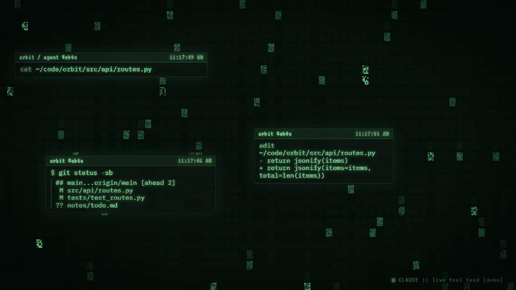
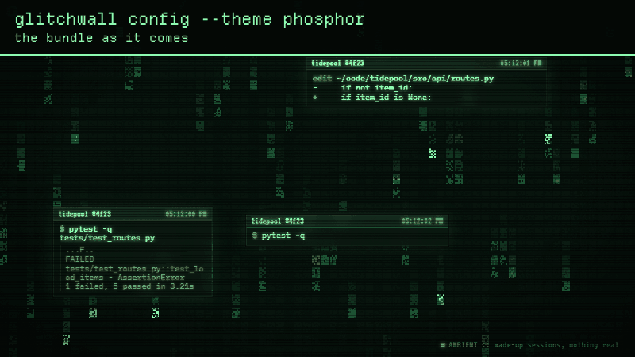
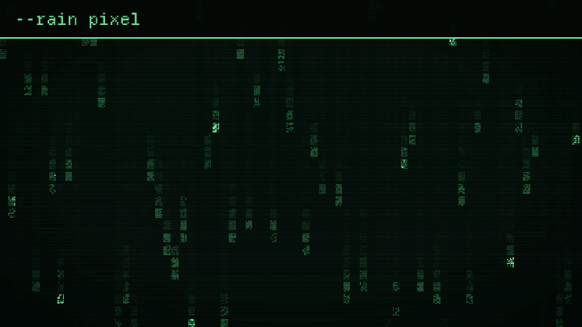
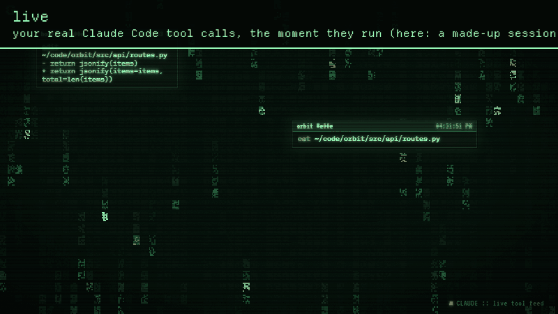
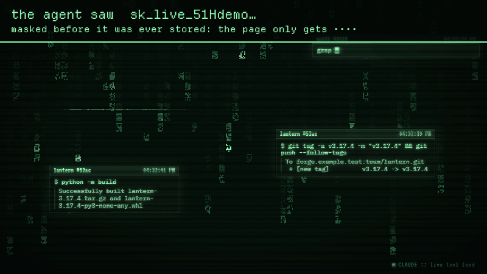
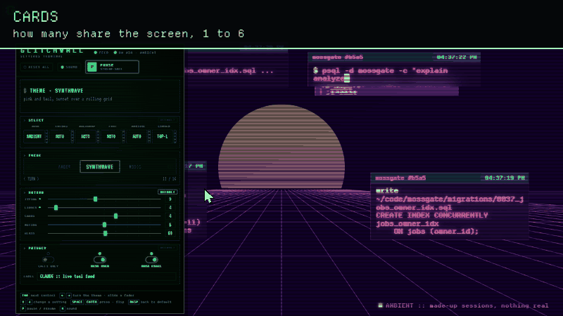
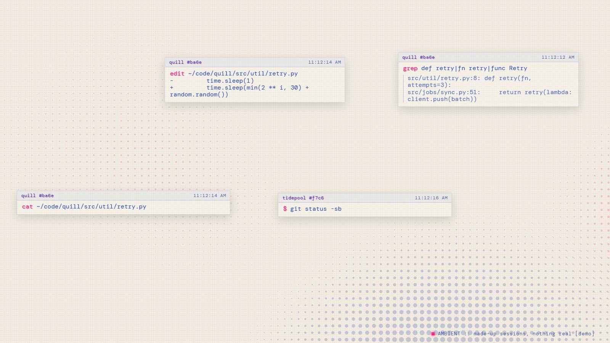
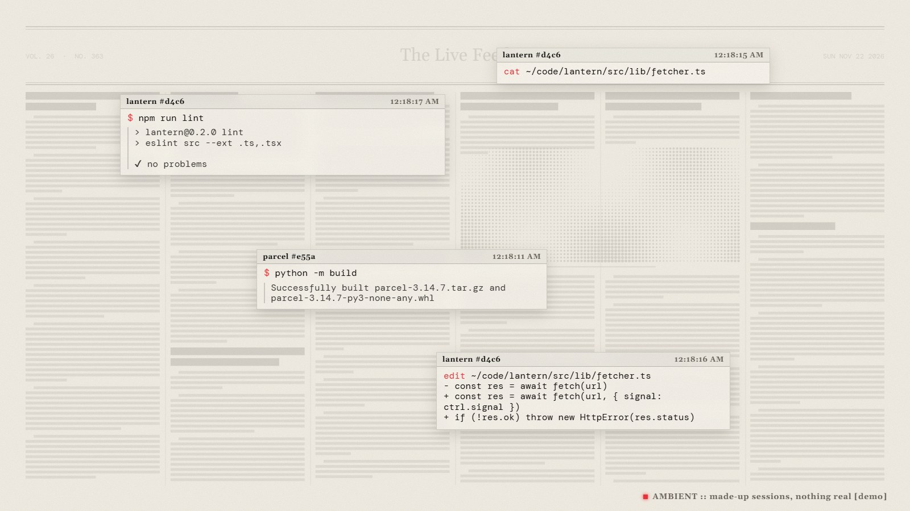
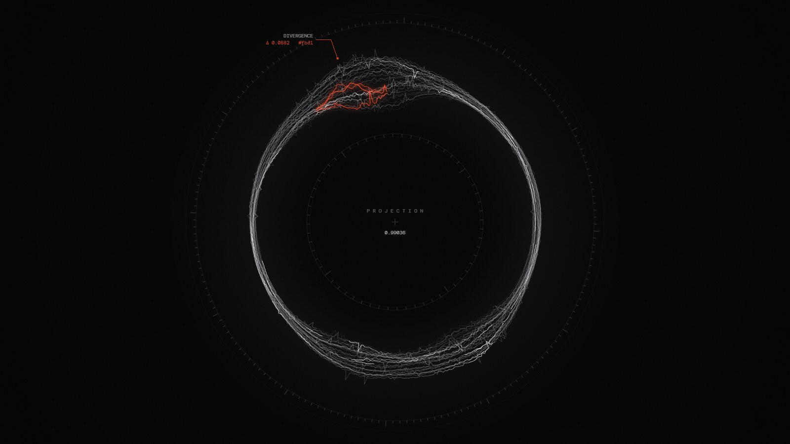
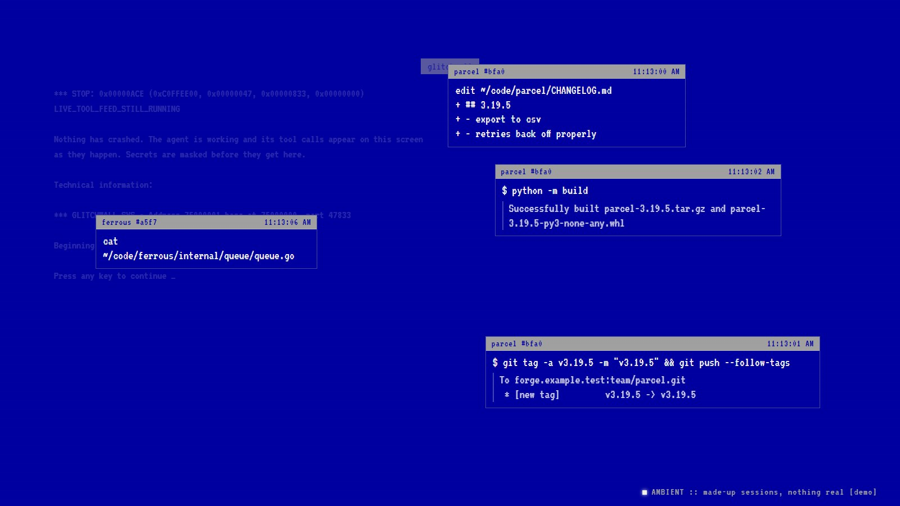

<div align="center">

# `g l i t c h w a l l`

**Your AI coding agent, live on your desktop.**
Every command it runs lands on your wallpaper, types itself out with its output, and fades away in the style of the theme you picked.


[](https://ko-fi.com/marklesterb28)



<sub>Recorded in demo mode with made-up commands. Notice the Stripe key and the bearer token: masked before they ever reached the screen.</sub>

**[Tour](#the-tour-) · [Quick start](#quick-start) · [Themes](#themes-) · [Commands](#commands) · [Privacy](#what-it-does-and-what-it-never-does) · [FAQ](#faq)**

</div>

---

Your agent does a hundred things a minute in a terminal you're not watching. **glitchwall** puts all of it on
your desktop, behind your icons: every command, file edit, search and web fetch appears the moment it runs and
types itself out with its result. Secrets are masked before anything is stored, nothing ever leaves your
machine, and one click clears the screen before you go live. No coding agent? It plays made-up sessions or just
the art.

- 🟩 **Live:** your real Claude Code tool calls as they happen, with their output.
- 🎨 **16 themes, 17 backgrounds, 19 fonts, 11 transitions:** mix any of them.
- 🔒 **Private:** masked before it's stored, localhost only, no telemetry, read-only on your logs.
- 🎥 **Stream-safe:** one switch and the screen is clean, enforced by the feed itself.
- 🖥️ **No wallpaper app:** on Windows it sits behind your desktop icons on every screen by itself.
- 🌙 **No code needed:** ambient mode plays made-up sessions forever; art mode is just the background.
- 🪶 **Small:** the Python standard library and one web page (plus [pywebview](https://github.com/r0x0r/pywebview) on Windows). Free and MIT licensed.

## The tour 🎬

Every clip below is the real page (and the real settings window), recorded with made-up data.

### Every call, the moment it runs

Shell and PowerShell commands, file reads, edits and writes, searches, web fetches and sub-agents each get a
card. The card types the call out, then its output underneath; a failing command's output shows in the
theme's error color. Cards
land somewhere free on the screen, linger a few seconds after they finish, and leave the way your theme likes.
The corner label shows a lamp that lights while calls are coming in. (That's the clip at the top of this page.)

It reads Claude Code's own session logs (read-only, only what's new), so there's nothing to set up in Claude
Code itself.

### Sixteen looks, each one complete


An oscilloscope, a blueprint, newsprint by day and night, neon, a field-ops poster, a risograph print, a record
sleeve, a school notebook, the old blue stop screen, a sun print, an all-seeing machine's ring of data, and four
classic terminals. Each theme is a finished bundle: colors, two fonts, a background, a texture, and its own way
of bringing cards in and taking them away (beam open and collapse, ruled in and erased, stamped and torn off,
written in and crumpled up...). The full list is under [Themes](#themes-).

### Make it yours



Five independent choices: start from a theme, then borrow another theme's colors, pick any background, any
font, any transition. Every change shows up on the running wallpaper within a second; nothing restarts.

### Seventeen backgrounds



Bit-glyph rain, katakana rain, a starfield, dead-channel static, snow, a synthwave sun, a drafting grid that
draws and dimensions its own shapes, a breathing halftone, a turning record, a jukebox, atomic-age starbursts,
a broadcast test card, mid-century wallpaper, the stop screen, a doodling notebook, the oracle's ring, or
nothing. The MOTION slider sets how busy any of them is, down to perfectly still.

### Three modes: no coding agent needed



| Mode | What you see | What it reads |
| --- | --- | --- |
| `live` (default) | your real Claude Code tool calls as they happen | your Claude Code logs, read-only |
| `ambient` | endless made-up coding sessions: a bug found and fixed, tests failing then passing, a build, a deploy, a release, with believable code, projects and numbers | nothing at all |
| `art` | just the themed background | nothing at all |

So glitchwall works as a wallpaper even if you don't write code. The corner label says which mode is on, so a
made-up session is never mistaken for a real one. `glitchwall install --mode ambient` to start that way,
`glitchwall config --mode art` (or the MODE selector) to switch any time.

### Secrets never reach the screen



Everything is masked in the feed *before* it's stored, so the page never even receives the real text: 50+ key
formats (cloud, Git hosts, payment, AI providers, package registries...), anything assigned to a secret-sounding
name, passwords in URLs, headers and command lines, long random-looking tokens, and your home folder, user
name and email. Details under [Redaction](#redaction).

### One switch before you go live


`glitchwall pause` (or the big PAUSE key in the settings, or **P**) and the feed stops serving: the wallpaper
wipes every card on screen within a second and the label says *paused*. Nothing that happens during a pause is
ever replayed. Put it in your stream-start script. Something in between? **CALLS ONLY** shows the calls but never
their output.

### A settings window that previews on the real thing


Open **glitchwall settings** from the Start menu, the desktop's right-click menu, the hot corner, or
`glitchwall settings`. Every control saves and applies the moment you touch it. **Hold** any slider, selector or
the theme drum and the window fades almost away, so the wallpaper itself is your preview; let go and it's back.
It speaks keyboard too (arrows turn and slide, Backspace puts a control back to default), clicks and clacks
like a piece of lab gear (**SOUND** or **M** turns that off; the wallpaper is always silent), and each section
has a DEFAULT key. **RESET ALL** (press twice) puts everything back and restarts the wallpaper fresh.

[](docs/shots/settings.png)

### Five sliders



**TYPING** speed (1 to 20), **LINGER** after a card finishes (2 to 30 s), **CARDS** on screen at once (1 to 6),
**MOTION** of the background (0 is still, 10 is full), and **GLASS** (see-through to solid cards). Also on the
command line: `glitchwall config --type-speed 8 --linger 12 --cards 3 --intensity 2 --glass 80`.

### A hot corner


Rest the mouse in the top-left corner of any screen for half a second and the settings open (or come to the
front). A small glitching glitchwall icon marks the corner. Pick any corner, or OFF, with the CORNER selector;
it never fires while a game or video is fullscreen.

### Dock it to an edge


Drag the settings window to the left, right or top edge of a screen and it docks there, on top. After a few idle
seconds it tucks itself into a thin strip; touch the strip and it slides back out. Drag it away to undock.
<sub>(Put together from the real settings window and wallpaper: docking happens on your desktop, not in a page.)</sub>

### Every screen, behind your icons


On Windows there's no wallpaper app to install: glitchwall puts one borderless window per screen behind your
desktop icons, using WebView2, the Edge engine built into Windows. Screens added, removed or rearranged are
picked up on their own, and so is a restarted Explorer. If the page's browser ever dies, glitchwall restarts
itself. Your own wallpaper is never changed: `stop` or `uninstall` uncovers it again. Only want the main screen?
`glitchwall install --screens primary`.

### Light on your PC

One small Python process that checks for new log lines once a second, and one web page per screen that draws
at most 30 frames a second, whatever your monitor's refresh rate. A screen covered by a maximized or
fullscreen window (a game, a video, your editor) goes to sleep until it's uncovered, and so does every screen
while the PC is locked: about 17% of one core awake, 2.4% asleep. MOTION at 0 stills the background entirely.
In Task Manager it shows up as **glitchwall**, not as an anonymous Python.

## Quick start

### 1 · Just look at it (nothing installed, no logs read)

From a clone of this repo:

```
uvx --from . glitchwall demo --open
```

Starts a fake feed and opens the wallpaper in your browser at `http://127.0.0.1:47834/`. Ctrl+C to stop.

### 2 · Windows

**With Python / uv**, from a clone of this repo:

```
uv tool install .
glitchwall install
```

**Without Python:** build the standalone exes (see [Development](#development)), unzip
`glitchwall-<version>-windows.zip`, then in that folder:

```
.\glitchwall.exe install
```

`install` first checks that everything it needs is there (Windows 10 1803 or newer, .NET Framework 4.7.2,
the WebView2 runtime) and offers to fetch what isn't: the WebView2 runtime comes straight from Microsoft, and
runs only if Windows confirms Microsoft signed it. Nothing is downloaded without a yes (`--yes` answers yes
for scripts). `glitchwall doctor` runs the same checks any time.

Then it starts the feed in the background, adds a start-at-logon entry, and puts the wallpaper behind
your desktop icons on every screen (Windows 10 gets WebView2 with Edge; Windows 11 has it built in). To change
anything, open **glitchwall settings** from the Start menu, the desktop's right-click menu (on Windows 11 under
*Show more options*), the hot corner, or `glitchwall settings`. See [the tour](#the-tour-) for what's in there.

The exe version copies `glitchwall.exe` and `glitchwall-feed.exe` (the windowed feed that starts
at logon, no console window) into `%USERPROFILE%\.glitchwall\bin`, so you can delete the download.
Use `%USERPROFILE%\.glitchwall\bin\glitchwall.exe pause` (or `resume`, `status`, `uninstall`) from then on.
The exes aren't code-signed, so SmartScreen may say "unknown publisher".

### 3 · macOS / Linux

```
uv tool install .
glitchwall install
```

This writes the wallpaper to the state folder, adds a login item (LaunchAgent / XDG autostart),
starts the feed and prints the page's `file://` path. Then either point a web-wallpaper app at it
([Plash](https://github.com/sindresorhus/Plash) on macOS, [Komorebi](https://github.com/Komorebi-Fork/komorebi)
or KDE's HTML wallpaper plugins on Linux), or open it fullscreen on a spare monitor:
`chromium --kiosk file:///path/to/index.html` (or `firefox --kiosk`).
A `file://` page sends `Origin: null`, which the feed accepts with the key.
<sub>The macOS/Linux path is written but not tested yet. Reports welcome.</sub>

## Themes 🎨


Each theme is a finished bundle: colors, two fonts, a background, a texture and its own way of bringing cards
in and taking them away. Use one as it is, or swap any single part.

| Theme | Personality | Cards arrive / leave |
| --- | --- | --- |
| `phosphor` (default) | lab oscilloscope at night: green phosphor on black glass, amber for anything live, CRT tube | beam opens / collapses to a dot |
| `drafting` | blueprint: chalk-white linework on cobalt, shapes drafting and dimensioning themselves | ruled in / erased |
| `newsprint` · `nightprint` | cream newsprint, black ink, hot vermilion; the same at night on charcoal | pressed on / lifted off |
| `neon` | near-black neon: cyan ink, hot pink, dot-matrix titles, katakana rain | tube flickers on / off |
| `fieldops` | field-ops poster: khaki stock, hot-orange tactical grid, stencil type | stamped / torn off |
| `duplicator` | risograph: blue and fluorescent-pink inks, halftone, the pink drum a little off true | second ink lands off true |
| `sleeve` | record sleeve: sepia paper, brown ink, mustard, a record turning in the corner | slides out of the sleeve |
| `notebook` | ruled paper, red margin, ballpoint handwriting, pencil doodles | written in / crumpled and tossed |
| `bsod` | the old blue stop screen: white VGA text, grey title chips | drawn line by line / gone |
| `cyanotype` | a sun print in Prussian blue, paper grain, a mid-century print | ruled in / erased |
| `oracle` | an all-seeing machine: one great ring of jagged data strokes on black, slowly turning and always redrawing itself, white ink and one signal red | opens like an iris / closes to a point |
| `matrix` · `amber` · `synthwave` · `msdos` | the original bright-green look, amber mono, a synthwave sunset, blue DOS boxes | glitch · beam · glitch · line by line |

**Mix and match.** Five independent choices; `theme` means "whatever the theme uses":

```sh
glitchwall themes                                   # list everything, * marks what you use now
glitchwall config --theme drafting                  # pick a bundle; the running wallpaper switches within a second
glitchwall config --palette sleeve                  # ...but with another theme's colors
glitchwall config --rain starburst --font vt323     # ...any background, any font
glitchwall config --transition neon                 # ...any way of arriving and leaving
glitchwall config --palette theme --rain theme --font theme --transition theme   # back to the bundle
glitchwall demo --open --theme notebook             # try one without touching your setup
```

| Choice | Options |
| --- | --- |
| **Background** (`--rain`) | `pixel` bit-glyph rain · `code` katakana rain · `stars` · `static` · `snow` · `grid` synthwave sun · `draft` drawing grid · `halftone` two-ink dots · `record` · `jukebox` · `starburst` atomic age · `testcard` · `print` mid-century wallpaper · `stop` stop screen · `notebook` ruled paper · `oracle` ring of data · `none` |
| **Font** | `departure` · `plex` · `vt323` · `chakra` · `doto` · `stencil` · `serif` · `courierprime` · `dmmono` · `fira` · `overpass` · `georgia` · `cascadia` · `consolas` · `lucida` · `courier` · `segoe` · `hand` · `mono` |
| **Transition** | `glitch` · `crt` · `draft` · `press` · `neon` · `stamp` · `riso` · `sleeve` · `dos` · `write` · `iris` |
| **Palette** | any theme name |

Fonts are bundled or already on your system; nothing is downloaded at run time. The sliders are
`glitchwall config --type-speed 1-20 --linger 2-30 --cards 1-6 --intensity 0-10 --glass 20-95`, and they
apply within a second. In a browser, URL parameters (`?theme=sleeve&rain=jukebox&transition=stamp`) win over
your settings, and `?cycle=10` steps through every theme. The background slider sets how busy any background is (0 stills it).

### Up close

Full-size shots (click one to open it). They come from ambient mode, so every session in them is made up.

<table>
<tr><td>

[](docs/shots/phosphor.jpg)<br><sub>phosphor</sub>

</td><td>

[](docs/shots/drafting.jpg)<br><sub>drafting</sub>

</td></tr>
<tr><td>

[](docs/shots/notebook.jpg)<br><sub>notebook</sub>

</td><td>

[](docs/shots/sleeve.jpg)<br><sub>sleeve</sub>

</td></tr>
<tr><td>

[](docs/shots/duplicator.jpg)<br><sub>duplicator</sub>

</td><td>

[](docs/shots/newsprint.jpg)<br><sub>newsprint</sub>

</td></tr>
<tr><td>

[](docs/shots/oracle.jpg)<br><sub>oracle</sub>

</td><td>

[](docs/shots/art-oracle.jpg)<br><sub>oracle, art mode</sub>

</td></tr>
<tr><td>

[](docs/shots/neon.jpg)<br><sub>neon</sub>

</td><td>

[](docs/shots/bsod.jpg)<br><sub>bsod</sub>

</td></tr>
<tr><td>

[](docs/shots/art-synthwave.jpg)<br><sub>synthwave, art mode</sub>

</td><td>

[](docs/shots/art-halftone.jpg)<br><sub>duplicator, art mode</sub>

</td></tr>
<tr><td>

[](docs/shots/art-starburst.jpg)<br><sub>sleeve + starburst, art mode</sub>

</td><td>

[](docs/shots/art-testcard.jpg)<br><sub>fieldops + testcard, art mode</sub>

</td></tr>
</table>

## Commands

| Command | What it does |
| --- | --- |
| `glitchwall install` | set everything up (`--mode ambient`, `--commands-only`, `--no-autostart`, `--screens primary`, `--yes`, `--port N`) |
| `glitchwall settings` | the settings: every setting below, applied as you change them (`--browser` opens it in your browser) |
| `glitchwall config --mode live\|ambient\|art` | real activity, made-up sessions, or background only |
| `glitchwall status` | what's installed and running |
| `glitchwall doctor` | check everything glitchwall needs, offer to fetch what's missing |
| `glitchwall reset` | every setting back to the default, wallpaper restarted fresh |
| `glitchwall start` / `stop` | start or stop the background feed |
| `glitchwall pause` / `resume` | stream-safe switch: serve nothing / back to live |
| `glitchwall config --commands-only on` | show calls, hide all output |
| `glitchwall config --label "TEXT"` | the text in the bottom-right corner |
| `glitchwall themes` | list themes, backgrounds and fonts |
| `glitchwall config --theme X --rain Y --font Z` | change the look, live |
| `glitchwall demo [--open]` | fake events + the page, for screenshots and trying it |
| `glitchwall export DIR` | write the wallpaper and its `config.js` to a folder (other wallpaper apps) |
| `glitchwall uninstall` | remove everything `install` added and put your old wallpaper back |

## What it does, and what it never does

> **TL;DR:** it reads your agent's logs, masks the secrets, and shows them to one page on your own machine. That's it.

### ✅ It reads

In `ambient` and `art` mode it reads no logs at all, only its own settings. In `live` mode:

- **Claude Code session logs:** `~/.claude/projects/*/*.jsonl` (or `$CLAUDE_CONFIG_DIR/projects`),
  opened **read-only**, only logs touched in the last 30 minutes, only the newly appended part.
  From each line it takes tool calls and their results.
- **Its own files:** a random key, `settings.json`, a pid file.

### 🚫 It never

- **Talks to the internet.** The feed listens on `127.0.0.1` only and makes no outgoing connections.
  No telemetry, no analytics, no update checks. The page loads nothing remote (the fonts are bundled).
  The one part glitchwall doesn't control: WebView2 is Microsoft's Edge engine, and it may talk to
  Microsoft for its own updates and safety checks the way Edge does. The page itself only ever asks `127.0.0.1`.
- **Writes to your logs**, or anywhere outside the files listed below.
- **Shows unmasked secrets.** Text is redacted *before* it's stored in memory, so there's nothing unredacted to leak. See [Redaction](#redaction).
- **Serves anyone but the wallpaper.** Every request needs:
  - the per-install random key, which only the wallpaper has (in its `config.js`, or after the `#` in the
    address of glitchwall's own windows, which is never sent to a server), compared in constant time;
  - a `Host` of `127.0.0.1`/`localhost` on the right port, which blocks DNS rebinding;
  - no `Origin`, `null` (a local file page), or the feed's own address (glitchwall's own windows load the
    page from the feed). Pages from other local servers are refused too.

  Changing a setting from the settings window needs all of that too, plus a JSON request sent from the
  feed's own address, so neither a website, a file page nor a plain form can change one. Port and screens
  can't be changed from it at all.

  Websites you visit can't read it. Refused requests are noted in `last-refused.txt`, without the key.

### 📁 Files it adds (all removed by `uninstall`)

| Where | What |
| --- | --- |
| `%USERPROFILE%\.glitchwall\` (Windows), `~/Library/Application Support/glitchwall/` (macOS), `~/.local/state/glitchwall/` (Linux) | key, settings, pid file, refusal note, `webview\` and `webview-settings\` (WebView2's caches for glitchwall's own windows), and `bin\` for the exe version |
| `HKCU\...\CurrentVersion\Run\glitchwall` / `~/.config/autostart/glitchwall.desktop` / `~/Library/LaunchAgents/io.github.glitchwall.plist` | start at logon |
| `%APPDATA%\Microsoft\Windows\Start Menu\Programs\glitchwall settings.lnk` | Windows: the settings window in the Start menu |
| `HKCU\Software\Classes\DesktopBackground\Shell\glitchwall` | Windows: *glitchwall settings* in the desktop's right-click menu |

**Why the home folder on Windows, not `%LOCALAPPDATA%`?** Packaged (MSIX) apps such as Claude Desktop
or Store terminals get new AppData folders redirected into a private copy. `install` run from one of
them and the feed started at logon would then read different key files, and every request would be
refused. Set `GLITCHWALL_HOME` to put the state somewhere else.

## Redaction

Applied to every command, file path and output before it's kept:

| Layer | What it catches |
| --- | --- |
| **Known formats** | AWS, Google, Azure (storage keys, SAS signatures), GitHub, GitLab, Slack (tokens and webhooks), Discord, Stripe, Anthropic, OpenAI, Hugging Face, npm, PyPI, NuGet, Docker Hub, DigitalOcean, HashiCorp Vault, Tailscale, SendGrid, Mailgun, Twilio, Doppler, Grafana, Netlify, Vercel, Telegram and more; JWTs; PEM / OpenSSH / PGP / PuTTY / age private keys |
| **By name** | `password=`, `API_KEY: …`, `"client_secret": "…"`, `export X_TOKEN=`, `$env:X_KEY =`, `setx`, `--password x`, `--api-key=x`, `mysql -pX`, `curl -u user:pass`, `Authorization:` / `Cookie:` / `X-Api-Key:` headers, `.netrc`, credentials in URLs and connection strings (`postgres://user:pass@`, `Password=…;`) |
| **High entropy** | long random-looking tokens (mixed case + digits, high Shannon entropy) and long hex strings, even with no known prefix |
| **Personal** | home folder → `~` (all Windows, Git Bash and WSL spellings), user name → `user`, email local parts → `••••` |
| **Optional** | `--commands-only` drops all tool output |

It errs toward masking. The tests in [`tests/test_redact.py`](tests/test_redact.py) feed 50+ realistic fake
secrets through it, plus ordinary text that must survive untouched.

## ⚠️ Disclaimers (please read)

- **Redaction is a safety net, not a guarantee.** It's pattern- and entropy-based. A secret with no
  known format, no telling variable name and low randomness (say, a dictionary-word password typed as a
  bare argument) can get through. **You are responsible for what's on your screen.** When streaming,
  recording or screen sharing, use `glitchwall pause`.
- **It can't protect you from local malware.** Any program already running as you can read your
  agent's logs and this tool's key file directly.
- **Your logs contain whatever your agent did.** glitchwall shows a masked slice of that; it doesn't
  decide what your agent runs.
- **`config.js` holds your feed key.** Don't publish an exported wallpaper folder. If you did, delete
  the `key` file in the state folder and run `glitchwall install` again.
- **Provided as is, with no warranty**, under the MIT license. See [LICENSE](LICENSE) and [SECURITY.md](SECURITY.md).
- **Not affiliated with Anthropic.** "Claude" and "Claude Code" are trademarks of
  Anthropic; they're named here only to say which logs glitchwall reads.
- **Free and open source, forever.** No accounts, no paid tier, no ads. Donations are appreciated but never
  required, and they don't unlock anything. See [Support](#support-).

## FAQ

**Will it slow my PC down?** Hardly: see [Light on your PC](#light-on-your-pc). For the lightest setup,
`glitchwall config --intensity 0` stills the background.

**Does it work with other agents?** It reads Claude Code's logs today. The parser is one small file
([`claude_logs.py`](src/glitchwall/claude_logs.py)), and pull requests for other agents are welcome.

**Can I change the look?** Yes: see [Themes](#themes-). A new theme is one entry in `THEMES` in
[`index.html`](src/glitchwall/wallpaper/index.html) plus its name in [`themes.py`](src/glitchwall/themes.py);
a test checks they agree. Pull requests welcome.

**Can I use another wallpaper app?** You don't need one: on Windows glitchwall puts itself behind your
icons. But the wallpaper is a plain web page and the feed is a local web server, so anything that can show
a web page can show it. `glitchwall export DIR` writes the page and its `config.js` to a folder. Use that folder in Wallpaper Engine
(Windows, as a web wallpaper), [Plash](https://github.com/sindresorhus/Plash) (macOS), a KDE or GNOME web
wallpaper plugin (Linux), a browser window in kiosk mode, or an OBS **browser source** to put your agent on
stream as an overlay (`glitchwall pause` still clears it instantly). Only glitchwall's own windows are tested so far;
reports welcome.

## Development

```
uv run python -m unittest discover -s tests                          # tests
uv build                                                             # wheel + sdist
powershell -File packaging\build-exe.ps1                             # standalone Windows exes + zip (PyInstaller, build time only)
uv run --no-project --with pillow --with websockets python tools/record_demo.py   # re-record docs/demo.gif
uv run --no-project --with pillow --with websockets python tools/theme_gallery.py  # rebuild docs/themes.png
uv run --no-project --with pillow --with websockets python tools/screenshots.py   # rebuild docs/shots/ (the "Up close" gallery)
uv run --no-project --with pillow --with websockets python tools/showcase.py      # re-record the tour's GIFs (docs/gifs/) and the settings still
uv run --no-project --with pillow python tools/make_icon.py                       # redraw the app icon (pixel art, 16-256 px)
```

Standard library only at runtime, Python 3.9+; on Windows, plus [pywebview](https://github.com/r0x0r/pywebview) for the desktop windows.

| File | Role |
| --- | --- |
| `src/glitchwall/claude_logs.py` | follow the logs, pair each call with its output |
| `src/glitchwall/redact.py` | all masking |
| `src/glitchwall/server.py` | the local feed and its access checks |
| `src/glitchwall/themes.py` | theme, background and font names (the colors live in the page) |
| `src/glitchwall/winhost.py` | Windows: the page behind the desktop icons, one window per screen |
| `src/glitchwall/prereqs.py` | what `install` and `doctor` check for, and fetching what's missing |
| `src/glitchwall/platforms.py` | autostart, background process, standalone exe |
| `src/glitchwall/wallpaper/` | the page itself (`index.html?still` renders without animation, for screenshots) and the settings window (`settings.html`) |

## Support ☕

glitchwall is **completely free** and always will be. Every theme, mode and feature is here for everyone, with no
paid version, no locked extras and no nagging. You don't owe anything to use it, share it or build on it.

If it brightens your desk and you'd like to say thanks, a donation is warmly appreciated but **never required**.
Starring the repo, reporting a bug or showing it to a friend helps just as much.

- 💚 [GitHub Sponsors](https://github.com/sponsors/marklesterb28): monthly or one-time, no fees taken by GitHub
- ☕ [Ko-fi](https://ko-fi.com/marklesterb28): a one-off coffee, card or PayPal

## License & credits

**MIT**, see [LICENSE](LICENSE). Free to use, change and share.
[Departure Mono](https://departuremono.com) is © Helena Zhang, SIL Open Font License 1.1, see [OFL.txt](src/glitchwall/wallpaper/OFL.txt).
VT323, IBM Plex Mono, Chakra Petch, Doto, Saira Stencil One, Instrument Serif, Courier Prime, DM Mono, Fira Code,
Overpass Mono, Gelasio, Caveat, Cascadia Mono and Inconsolata are bundled under the SIL Open Font License 1.1 (from [Google Fonts](https://github.com/google/fonts));
each license is in [fonts/licenses](src/glitchwall/wallpaper/fonts/licenses).
The first eight themes' palettes, and the grain, scanline and halftone textures, are adapted from the themes of
[SUB/WAVE](https://github.com/perminder-klair/subwave) by Parminder Klair (MIT). Go check it out, it's a lovely
self-hosted radio station. Notice in [THIRD_PARTY_NOTICES.md](THIRD_PARTY_NOTICES.md).
Desktop windows on Windows: [pywebview](https://github.com/r0x0r/pywebview) (BSD-3-Clause) with
[pythonnet](https://github.com/pythonnet/pythonnet) (MIT) and Microsoft's WebView2.

<div align="center"><sub>made for people who like watching the machine think</sub></div>
