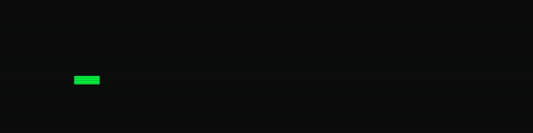

<div align="center">

# 

**Your coding agent, live on your desktop.**<br>
Every command it runs types itself out on your wallpaper, then leaves the way your theme likes.


<sub>A made-up session. The Stripe key and the bearer token were masked before they ever reached the screen.</sub>

**[Install](#install) · [Themes](#themes) · [Settings](#settings) · [Privacy](#privacy) · [Commands](#commands) · [FAQ](#faq)**

</div>

---

| 🔒 Private | 🪶 Light | 🎥 Stream-safe |
| --- | --- | --- |
| Secrets are masked before anything is stored. It reads your agent's logs read-only and talks to `127.0.0.1` only. [What it reads, and never does →](docs/PRIVACY.md) | About 6.5% of one CPU core and 153 MB, drawn by a small Rust renderer with no browser. Covered screens sleep. [The numbers →](docs/PERFORMANCE.md) | Press **P** and every card is gone at once, enforced by the feed itself. Nothing from a pause is ever replayed. |

## What you see

Your agent does a hundred things a minute in a terminal you're not watching. glitchwall puts them on your desktop,
behind your icons: every shell command, file read and edit, search, web fetch and sub-agent gets a card the moment
it runs, types itself out with its result, lingers, and leaves. A failing command's output shows in the theme's
error color.

It reads Claude Code's own session logs, so there's nothing to set up in Claude Code. No agent, or not working
right now? Two other modes keep it a wallpaper:

| Mode | What you see | What it reads |
| --- | --- | --- |
| `live` (default) | your agent's tool calls as they happen | your Claude Code logs, read-only |
| `ambient` | endless made-up coding sessions: a bug found and fixed, tests failing then passing, a release | nothing |
| `art` | just the background | nothing |

The corner label always says which mode is on, so a made-up session is never mistaken for a real one.

## Themes

Nineteen complete looks. Each one is colors, two fonts, a background, a texture, and its own way of bringing
cards in and taking them away. Use one as it is, or take any part from another: the colors of one, the
background of a second, the font of a third.

<table>
<tr>
<td><br><sub><b>phosphor</b> · green terminal, glyph rain</sub></td>
<td><br><sub><b>drafting</b> · a blueprint drawing itself</sub></td>
<td><br><sub><b>neon</b> · a rainy street at night</sub></td>
<td><br><sub><b>orb</b> · the machine in its hall</sub></td>
</tr>
<tr>
<td><br><sub><b>notebook</b> · ballpoint and doodles</sub></td>
<td><br><sub><b>sleeve</b> · a record turning</sub></td>
<td><br><sub><b>scope</b> · an oscilloscope beam</sub></td>
<td><br><sub><b>chalkboard</b> · written, then wiped</sub></td>
</tr>
</table>

<sub>…and eleven more: newsprint, nightprint, fieldops, duplicator, bsod, cyanotype, oracle, matrix, amber,
synthwave and msdos. 27 backgrounds in all, each with four options of its own.
**[Every theme, background, font and transition →](docs/THEMES.md)**</sub>

**No videos, no GIFs.** Every background is a small program drawing each frame live: the rain picks where its
next glyph falls, the record works out how far it has turned. That's why no two minutes look the same, and why
any background can be recolored or slowed to a stop.

## Install

1. Get **[uv](https://docs.astral.sh/uv/)** if you don't have it.
2. Download `glitchwall-0.5.0-py3-none-win_amd64.whl` from Releases, then:

```
uv tool install glitchwall-0.5.0-py3-none-win_amd64.whl
glitchwall install
```

| Needs | Download | Installed |
| --- | --- | --- |
| Windows 10 1803 or newer, .NET Framework 4.7.2 and WebView2 (Windows 11 has both) | 2.9 MB | about 78 MB, including the Python uv sets up |

`install` checks those first. If one is missing it stops, says which, and offers to open Microsoft's download
page; glitchwall itself never downloads or installs anything. Then it starts the feed, adds a start-at-logon
entry, and puts the wallpaper behind your icons on every screen. Your own wallpaper is never changed:
`glitchwall stop` or `glitchwall uninstall` uncovers it again.

**Just want to look first?** `uvx --from glitchwall-0.5.0-py3-none-win_amd64.whl glitchwall demo --open` plays
made-up calls in your browser, with nothing installed and no logs read.

## Settings


Open **glitchwall settings** from the tray icon, the Start menu, the desktop's right-click menu, a hot corner,
or `glitchwall settings`. Everything applies to the wallpaper within a second; nothing restarts.

- **A theme drum** that previews every theme in its own colors and fonts.
- **Knobs that show what they pick:** COLORS as a swatch, FONT in its own face (with a sample line in the
  info bar), BACKDROP as a still of the background, ARRIVAL by playing its animation.
- **Four options** for whichever background is on, and six sliders: typing speed, linger, cards on screen,
  motion, glass and grain.
- **Hold** any control and the window fades almost away, so the wallpaper itself is the preview.
- **Dock it** to a screen edge and it tucks into a thin strip while idle.
- **PAUSE** sounds like a radio going off air and back. The window's clicks and squelch can be muted with
  **M**; the wallpaper itself is always silent.
- Keyboard all the way: arrows turn and slide, Backspace puts a control back to default.

The window wears the theme you picked and never scrolls. It costs about 108 MB of memory while open and nothing
once closed.

## Privacy

glitchwall shows your agent's activity on your screen, so it's built to be easy to trust and easy to check:

- **It reads one thing:** in `live` mode, Claude Code's session logs, read-only, only what's new. In
  `ambient` and `art` mode, no logs at all.
- **It masks before it stores.** 50+ key formats, anything with a secret-sounding name, passwords in URLs and
  command lines, long random-looking tokens, and your home folder, user name and email. The page never even
  receives the real text.
- **It stays on your PC.** The feed listens on `127.0.0.1` only, needs a per-install random key, and refuses
  other websites and other local servers. No telemetry, no update checks, nothing remote loaded.
- **It doesn't watch you.** Not your terminal, not your typing, not what's in other windows. It only notes where
  windows are, to stop drawing when one covers the screen, and where the mouse is, for the hot corner. A feature
  that showed your own terminal commands was built and then removed on purpose, because a wallpaper shouldn't
  look like spyware.

Redaction is a safety net, not a guarantee: when you stream or share your screen, press **P**.
**[Everything it reads, writes and refuses, and why →](docs/PRIVACY.md)**

## Commands

| Command | What it does |
| --- | --- |
| `glitchwall install` / `uninstall` | set everything up / remove all of it (`--mode ambient`, `--commands-only`, `--no-autostart`, `--screens primary`) |
| `glitchwall settings` | open the settings window |
| `glitchwall pause` / `resume` | stream-safe: serve nothing / back to live |
| `glitchwall start` / `stop` / `status` | the background feed |
| `glitchwall config --theme X --palette Y --rain Z --font F --transition T` | change the look, live |
| `glitchwall config --mode live\|ambient\|art` | real calls, made-up sessions, or background only |
| `glitchwall config --type-speed 1-20 --linger 2-30 --cards 1-6 --intensity 0-10 --glass 20-95 --grain 0-10` | the sliders |
| `glitchwall config --commands-only on` | show calls, never their output |
| `glitchwall themes` | list themes, backgrounds, fonts and transitions |
| `glitchwall doctor` | check everything glitchwall needs |
| `glitchwall reset` | every setting back to the default |
| `glitchwall demo --open` | made-up calls in your browser, no logs read |
| `glitchwall export DIR` | the page and its `config.js`, for OBS or Wallpaper Engine |

## FAQ

**Will it slow my PC down?** About 6.5% of one core (0.4% of a 16-core CPU) and 153 MB: about the CPU of a
simple web wallpaper, with less memory. Screens covered by a window, a fullscreen game or a locked PC draw nothing
(under 1% of one core in all). `--intensity 0` stills
the background entirely. [Compared with other live wallpapers →](docs/PERFORMANCE.md)

**Does it work with other agents?** Claude Code today. The log reader is one small file
([`claude_logs.py`](src/glitchwall/claude_logs.py)); pull requests for other agents are welcome.

**macOS or Linux?** Not today. The renderer draws with Direct2D and sits behind the icons through the Windows
desktop, and there are no Macs or Linux PCs here to test on.

**Can I put it on stream?** Yes: `glitchwall export DIR` writes the page for an OBS browser source or
Wallpaper Engine, and `glitchwall pause` still clears it at once.

**Can I make a theme?** Themes live in [`looks.js`](src/glitchwall/wallpaper/looks.js). A new background is a
canvas scene in the page plus a Rust port; see [CONTRIBUTING.md](CONTRIBUTING.md).

## Support

glitchwall is free and always will be: no paid tier, no locked extras, no nagging. If it brightens your desk, a
[Ko-fi coffee](https://ko-fi.com/marklesterb28) is warmly appreciated and never required. A star, a bug report or
showing it to a friend helps just as much.

## Credits & license

**MIT**, see [LICENSE](LICENSE) and [SECURITY.md](SECURITY.md). Not affiliated with Anthropic: "Claude" and
"Claude Code" are Anthropic's trademarks, named only to say which logs glitchwall reads.

Every font is bundled under the SIL Open Font License 1.1: Departure Mono © Helena Zhang
([OFL.txt](src/glitchwall/wallpaper/OFL.txt)), and VT323, IBM Plex Mono, Chakra Petch, Doto, Saira Stencil One,
Instrument Serif, Courier Prime, DM Mono, Fira Code, Overpass Mono, Gelasio, Caveat, Cascadia Mono, Inconsolata
and DotGothic16 from [Google Fonts](https://github.com/google/fonts)
([licenses](src/glitchwall/wallpaper/fonts/licenses)). The first eight themes' palettes and the grain, scanline
and halftone textures are adapted from [SUB/WAVE](https://github.com/perminder-klair/subwave) by Parminder Klair
(MIT), a lovely self-hosted radio station; see [THIRD_PARTY_NOTICES.md](THIRD_PARTY_NOTICES.md). The settings
window uses [pywebview](https://github.com/r0x0r/pywebview) (BSD-3-Clause), [pythonnet](https://github.com/pythonnet/pythonnet)
(MIT) and Microsoft's WebView2.

How it was made, from the first idea to the Rust renderer: [docs/HISTORY.md](docs/HISTORY.md).

<div align="center"><sub>made for people who like watching the machine think</sub></div>
